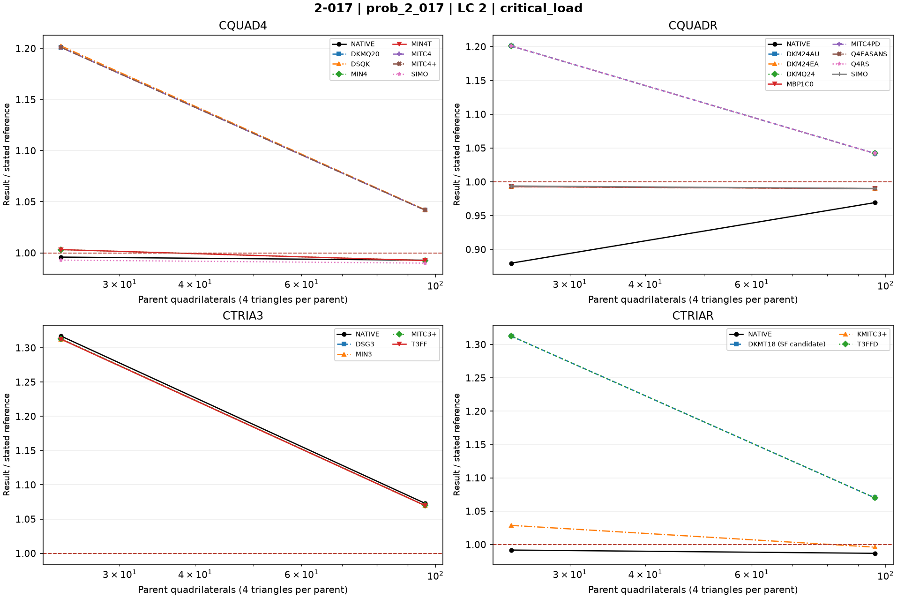

# Linear shells — 2-017: Column in-plane buckling

25 October 2026. Fresh native MYSTRAN and Nastran runs. CQUAD4, CQUADR, CTRIA3 and CTRIAR only.

[All linear comparisons](comparison_all_linear.md) · [Full CSV](comparison_all_linear.csv) · [Tested DAT](DAT/linear_shell_benchmark_DAT.zip) · [Linear publication QA](PUBLICATION_QA_linear.md)

Case IDs retain source-model filenames; actual element and formulation are given by their columns and deck selectors. Two-axis 2-002 tip observables use the two physical corner nodes.

NATIVE means the Nastran result for the corresponding element card: CQUAD4, CQUADR, CTRIA3 or CTRIAR. It does not mean the same proprietary interpolation as a MYSTRAN selector. Curves use independent/analytical references; published SAP2000 values are separate table columns. A completed solve is not a physical-accuracy pass. Zero references use absolute residuals; missing and failed output is never replaced by zero.

The tested source snapshot includes DKMT18 SF as an explicitly labelled candidate and corrected DSG3 local-z Kg. It is documented in [source provenance](data_linear/provenance_linear.json), with a reproducible element-local patch. This benchmark snapshot is not a declaration that SF passed every production-promotion gate. No shared eigensolver prototype is included.

## Model and comparison scope

2x12 and 4x24 in-plane column buckling. Active UX,UZ,RY only; lower UX pin and UZ rollers; preserve unit total top force. Pcr=lambda*1 kip, independent=127.91 kip.

MYSTRAN requests six eigenpairs with explicit `PARAM,ARP_TOL,1.0E-10`, default DARPACK and the unchanged physical-pencil residual limit 1e-6. No optional refinement/Jacobi solver changes are active. Nastran uses varying-load STATSUB=1; MYSTRAN uses STATSUB(PRELOAD)=1. 2-016 Nastran bounds the extraction to 0<lambda<0.01. Failed eigenpair acceptance remains SOLVER_ERROR, even if process return code is zero.

Inactive UY,RX,RZ (246) are applied to every node, with SPC1 cards split to at most six IDs. The SAP acceptance reference is the first Pcr=127.91 kip; this is distinguished from the additional six-mode numerical acceptance.

## Extraction status

| Solver | Status | Metric rows |
|---|---|---:|
| MYSTRAN | MEASURED | 44 |
| NASTRAN | MEASURED | 8 |

## Figures

### prob_2_017 · LC 2 · critical_load

## Finest available mesh per named series

| Case / parent quads | Solver / formulation | LC | Quantity | Measured | Independent / analytical | CSI published | Unit | Error % primary | Absolute residual | Status |
|---|---|---:|---|---:|---:|---:|---|---:|---:|---|
| prob_2_017_nx4_ny24_cquadr_dkmq24 / 96 | MYSTRAN CQUAD4_DKMQ20 | 2 | critical_load | 133.2703 | 127.91 | — | kip | 4.190681 | 5.3603 | MEASURED |
| prob_2_017_nx4_ny24_cquadr_dkmq24 / 96 | MYSTRAN CQUAD4_DSQK | 2 | critical_load | 133.3172 | 127.91 | — | kip | 4.227347 | 5.4072 | MEASURED |
| prob_2_017_nx4_ny24_cquadr_dkmq24 / 96 | MYSTRAN CQUAD4_MIN4 | 2 | critical_load | 126.9506 | 127.91 | — | kip | 0.7500586 | 0.9594 | MEASURED |
| prob_2_017_nx4_ny24_cquadr_dkmq24 / 96 | MYSTRAN CQUAD4_MIN4T | 2 | critical_load | 126.9506 | 127.91 | — | kip | 0.7500586 | 0.9594 | MEASURED |
| prob_2_017_nx4_ny24_cquadr_dkmq24 / 96 | MYSTRAN CQUAD4_MITC4 | 2 | critical_load | 133.2701 | 127.91 | — | kip | 4.190525 | 5.3601 | MEASURED |
| prob_2_017_nx4_ny24_cquadr_dkmq24 / 96 | MYSTRAN CQUAD4_MITC4plus | 2 | critical_load | 133.2701 | 127.91 | — | kip | 4.190525 | 5.3601 | MEASURED |
| prob_2_017_nx4_ny24_cquadr_dkmq24 / 96 | MYSTRAN CQUAD4_SIMO | 2 | critical_load | 126.6228 | 127.91 | — | kip | 1.006333 | 1.2872 | MEASURED |
| prob_2_017_nx4_ny24_cquadr_dkmq24 / 96 | MYSTRAN CQUADR_DKM24AU | 2 | critical_load | 133.2703 | 127.91 | — | kip | 4.190681 | 5.3603 | MEASURED |
| prob_2_017_nx4_ny24_cquadr_dkmq24 / 96 | MYSTRAN CQUADR_DKM24EA | 2 | critical_load | 126.6229 | 127.91 | — | kip | 1.006254 | 1.2871 | MEASURED |
| prob_2_017_nx4_ny24_cquadr_dkmq24 / 96 | MYSTRAN CQUADR_DKMQ24 | 2 | critical_load | 133.2703 | 127.91 | — | kip | 4.190681 | 5.3603 | MEASURED |
| prob_2_017_nx4_ny24_cquadr_dkmq24 / 96 | MYSTRAN CQUADR_MBP1C0 | 2 | critical_load | 126.6229 | 127.91 | — | kip | 1.006254 | 1.2871 | MEASURED |
| prob_2_017_nx4_ny24_cquadr_dkmq24 / 96 | MYSTRAN CQUADR_MITC4PD | 2 | critical_load | 133.2703 | 127.91 | — | kip | 4.190681 | 5.3603 | MEASURED |
| prob_2_017_nx4_ny24_cquadr_dkmq24 / 96 | MYSTRAN CQUADR_Q4EASANS | 2 | critical_load | 126.6229 | 127.91 | — | kip | 1.006254 | 1.2871 | MEASURED |
| prob_2_017_nx4_ny24_cquadr_dkmq24 / 96 | MYSTRAN CQUADR_Q4RS | 2 | critical_load | 133.2701 | 127.91 | — | kip | 4.190525 | 5.3601 | MEASURED |
| prob_2_017_nx4_ny24_cquadr_dkmq24 / 96 | MYSTRAN CQUADR_SIMO | 2 | critical_load | 126.6542 | 127.91 | — | kip | 0.9817841 | 1.2558 | MEASURED |
| prob_2_017_nx4_ny24_cquadr_dkmq24 / 96 | MYSTRAN CTRIA3_DSG3 | 2 | critical_load | 136.8451 | 127.91 | — | kip | 6.985459 | 8.9351 | MEASURED |
| prob_2_017_nx4_ny24_cquadr_dkmq24 / 96 | MYSTRAN CTRIA3_MIN3 | 2 | critical_load | 136.843 | 127.91 | — | kip | 6.983817 | 8.933 | MEASURED |
| prob_2_017_nx4_ny24_cquadr_dkmq24 / 96 | MYSTRAN CTRIA3_MITC3plus | 2 | critical_load | 136.864 | 127.91 | — | kip | 7.000235 | 8.954 | MEASURED |
| prob_2_017_nx4_ny24_cquadr_dkmq24 / 96 | MYSTRAN CTRIA3_T3FF | 2 | critical_load | 136.843 | 127.91 | — | kip | 6.983817 | 8.933 | MEASURED |
| prob_2_017_nx4_ny24_cquadr_dkmq24 / 96 | MYSTRAN CTRIAR_DKMT18 (SF candidate) | 2 | critical_load | 136.843 | 127.91 | — | kip | 6.983817 | 8.933 | MEASURED |
| prob_2_017_nx4_ny24_cquadr_dkmq24 / 96 | MYSTRAN CTRIAR_KMITC3plus | 2 | critical_load | 127.3982 | 127.91 | — | kip | 0.4001251 | 0.5118 | MEASURED |
| prob_2_017_nx4_ny24_cquadr_dkmq24 / 96 | MYSTRAN CTRIAR_T3FFD | 2 | critical_load | 136.843 | 127.91 | — | kip | 6.983817 | 8.933 | MEASURED |
| prob_2_017_nx4_ny24_cquadr_dkmq24 / 96 | NASTRAN CQUAD4_NATIVE | 2 | critical_load | 126.9939 | 127.91 | — | kip | 0.7162067 | 0.9161 | MEASURED |
| prob_2_017_nx4_ny24_cquadr_dkmq24 / 96 | NASTRAN CQUADR_NATIVE | 2 | critical_load | 123.9762 | 127.91 | — | kip | 3.075444 | 3.9338 | MEASURED |
| prob_2_017_nx4_ny24_cquadr_dkmq24 / 96 | NASTRAN CTRIA3_NATIVE | 2 | critical_load | 137.259 | 127.91 | — | kip | 7.309045 | 9.349 | MEASURED |
| prob_2_017_nx4_ny24_cquadr_dkmq24 / 96 | NASTRAN CTRIAR_NATIVE | 2 | critical_load | 126.2154 | 127.91 | — | kip | 1.324838 | 1.6946 | MEASURED |

All mesh rows, missing fields, hashes and run statuses remain in the CSV.
