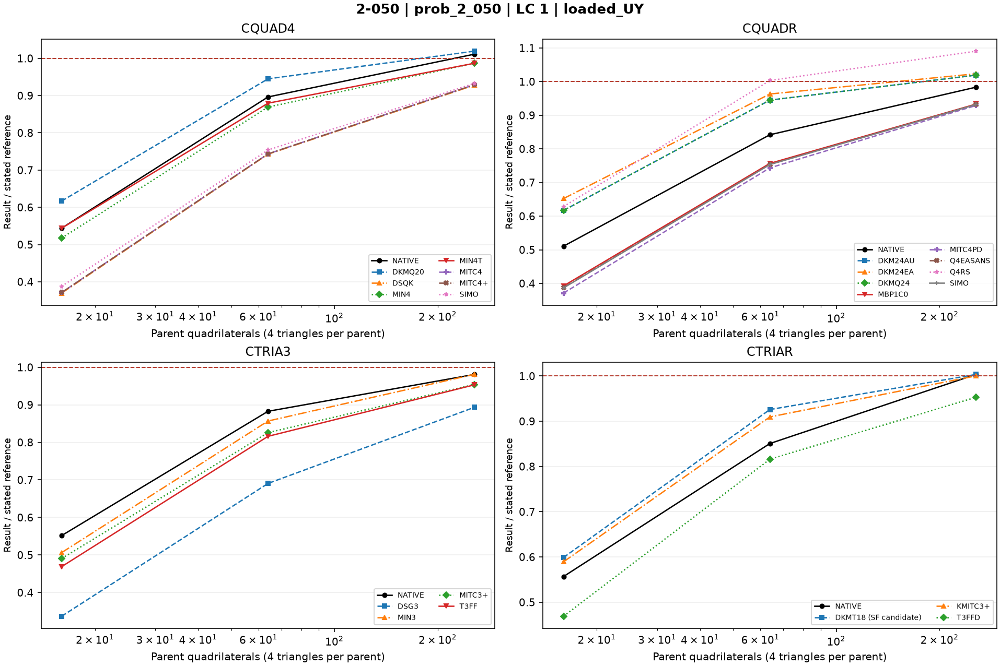

# Linear shells — 2-050: Pinched cylinder

25 October 2026. Fresh native MYSTRAN and Nastran runs. CQUAD4, CQUADR, CTRIA3 and CTRIAR only.

[All linear comparisons](comparison_all_linear.md) · [Full CSV](comparison_all_linear.csv) · [Tested DAT](DAT/linear_shell_benchmark_DAT.zip) · [Linear publication QA](PUBLICATION_QA_linear.md)

Case IDs retain source-model filenames; actual element and formulation are given by their columns and deck selectors. Two-axis 2-002 tip observables use the two physical corner nodes.

NATIVE means the Nastran result for the corresponding element card: CQUAD4, CQUADR, CTRIA3 or CTRIAR. It does not mean the same proprietary interpolation as a MYSTRAN selector. Curves use independent/analytical references; published SAP2000 values are separate table columns. A completed solve is not a physical-accuracy pass. Zero references use absolute residuals; missing and failed output is never replaced by zero.

The tested source snapshot includes DKMT18 SF as an explicitly labelled candidate and corrected DSG3 local-z Kg. It is documented in [source provenance](data_linear/provenance_linear.json), with a reproducible element-local patch. This benchmark snapshot is not a declaration that SF passed every production-promotion gate. No shared eigensolver prototype is included.

## Model and comparison scope

Classical pinched cylinder R=300,L=600,t=3,E=3e6,nu=.3; one-eighth symmetry with P/4=0.25 at the loaded node. Independent loaded UY=-1.8248e-5 in. Centroid split remains on parent facets.

## Extraction status

| Solver | Status | Metric rows |
|---|---|---:|
| MYSTRAN | MEASURED | 66 |
| NASTRAN | MEASURED | 12 |

## Figures

### prob_2_050 · LC 1 · loaded_UY

## Finest available mesh per named series

| Case / parent quads | Solver / formulation | LC | Quantity | Measured | Independent / analytical | CSI published | Unit | Error % primary | Absolute residual | Status |
|---|---|---:|---|---:|---:|---:|---|---:|---:|---|
| prob_2_050_nx16_cquadr_simo / 256 | MYSTRAN CQUAD4_DKMQ20 | 1 | loaded_UY | -1.859915e-05 | -1.8248e-05 | — | in | 1.92432 | 3.5115e-07 | MEASURED |
| prob_2_050_nx16_cquadr_simo / 256 | MYSTRAN CQUAD4_DSQK | 1 | loaded_UY | -1.693321e-05 | -1.8248e-05 | — | in | 7.205118 | 1.31479e-06 | MEASURED |
| prob_2_050_nx16_cquadr_simo / 256 | MYSTRAN CQUAD4_MIN4 | 1 | loaded_UY | -1.800442e-05 | -1.8248e-05 | — | in | 1.334831 | 2.4358e-07 | MEASURED |
| prob_2_050_nx16_cquadr_simo / 256 | MYSTRAN CQUAD4_MIN4T | 1 | loaded_UY | -1.800644e-05 | -1.8248e-05 | — | in | 1.323762 | 2.4156e-07 | MEASURED |
| prob_2_050_nx16_cquadr_simo / 256 | MYSTRAN CQUAD4_MITC4 | 1 | loaded_UY | -1.695651e-05 | -1.8248e-05 | — | in | 7.077433 | 1.29149e-06 | MEASURED |
| prob_2_050_nx16_cquadr_simo / 256 | MYSTRAN CQUAD4_MITC4plus | 1 | loaded_UY | -1.695651e-05 | -1.8248e-05 | — | in | 7.077433 | 1.29149e-06 | MEASURED |
| prob_2_050_nx16_cquadr_simo / 256 | MYSTRAN CQUAD4_SIMO | 1 | loaded_UY | -1.701931e-05 | -1.8248e-05 | — | in | 6.733286 | 1.22869e-06 | MEASURED |
| prob_2_050_nx16_cquadr_simo / 256 | MYSTRAN CQUADR_DKM24AU | 1 | loaded_UY | -1.859915e-05 | -1.8248e-05 | — | in | 1.92432 | 3.5115e-07 | MEASURED |
| prob_2_050_nx16_cquadr_simo / 256 | MYSTRAN CQUADR_DKM24EA | 1 | loaded_UY | -1.867411e-05 | -1.8248e-05 | — | in | 2.335105 | 4.2611e-07 | MEASURED |
| prob_2_050_nx16_cquadr_simo / 256 | MYSTRAN CQUADR_DKMQ24 | 1 | loaded_UY | -1.859915e-05 | -1.8248e-05 | — | in | 1.92432 | 3.5115e-07 | MEASURED |
| prob_2_050_nx16_cquadr_simo / 256 | MYSTRAN CQUADR_MBP1C0 | 1 | loaded_UY | -1.702963e-05 | -1.8248e-05 | — | in | 6.676732 | 1.21837e-06 | MEASURED |
| prob_2_050_nx16_cquadr_simo / 256 | MYSTRAN CQUADR_MITC4PD | 1 | loaded_UY | -1.695495e-05 | -1.8248e-05 | — | in | 7.085982 | 1.29305e-06 | MEASURED |
| prob_2_050_nx16_cquadr_simo / 256 | MYSTRAN CQUADR_Q4EASANS | 1 | loaded_UY | -1.701775e-05 | -1.8248e-05 | — | in | 6.741835 | 1.23025e-06 | MEASURED |
| prob_2_050_nx16_cquadr_simo / 256 | MYSTRAN CQUADR_Q4RS | 1 | loaded_UY | -1.989879e-05 | -1.8248e-05 | — | in | 9.046416 | 1.65079e-06 | MEASURED |
| prob_2_050_nx16_cquadr_simo / 256 | MYSTRAN CQUADR_SIMO | 1 | loaded_UY | -1.700401e-05 | -1.8248e-05 | — | in | 6.817131 | 1.24399e-06 | MEASURED |
| prob_2_050_nx16_cquadr_simo / 256 | MYSTRAN CTRIA3_DSG3 | 1 | loaded_UY | -1.62996e-05 | -1.8248e-05 | — | in | 10.67733 | 1.9484e-06 | MEASURED |
| prob_2_050_nx16_cquadr_simo / 256 | MYSTRAN CTRIA3_MIN3 | 1 | loaded_UY | -1.790517e-05 | -1.8248e-05 | — | in | 1.878726 | 3.4283e-07 | MEASURED |
| prob_2_050_nx16_cquadr_simo / 256 | MYSTRAN CTRIA3_MITC3plus | 1 | loaded_UY | -1.741338e-05 | -1.8248e-05 | — | in | 4.573762 | 8.3462e-07 | MEASURED |
| prob_2_050_nx16_cquadr_simo / 256 | MYSTRAN CTRIA3_T3FF | 1 | loaded_UY | -1.739392e-05 | -1.8248e-05 | — | in | 4.680403 | 8.5408e-07 | MEASURED |
| prob_2_050_nx16_cquadr_simo / 256 | MYSTRAN CTRIAR_DKMT18 (SF candidate) | 1 | loaded_UY | -1.831184e-05 | -1.8248e-05 | — | in | 0.3498466 | 6.384e-08 | MEASURED |
| prob_2_050_nx16_cquadr_simo / 256 | MYSTRAN CTRIAR_KMITC3plus | 1 | loaded_UY | -1.825559e-05 | -1.8248e-05 | — | in | 0.0415936 | 7.59e-09 | MEASURED |
| prob_2_050_nx16_cquadr_simo / 256 | MYSTRAN CTRIAR_T3FFD | 1 | loaded_UY | -1.739392e-05 | -1.8248e-05 | — | in | 4.680403 | 8.5408e-07 | MEASURED |
| prob_2_050_nx16_cquadr_simo / 256 | NASTRAN CQUAD4_NATIVE | 1 | loaded_UY | -1.8451e-05 | -1.8248e-05 | — | in | 1.112451 | 2.03e-07 | MEASURED |
| prob_2_050_nx16_cquadr_simo / 256 | NASTRAN CQUADR_NATIVE | 1 | loaded_UY | -1.794722e-05 | -1.8248e-05 | — | in | 1.64829 | 3.0078e-07 | MEASURED |
| prob_2_050_nx16_cquadr_simo / 256 | NASTRAN CTRIA3_NATIVE | 1 | loaded_UY | -1.789867e-05 | -1.8248e-05 | — | in | 1.914347 | 3.4933e-07 | MEASURED |
| prob_2_050_nx16_cquadr_simo / 256 | NASTRAN CTRIAR_NATIVE | 1 | loaded_UY | -1.831599e-05 | -1.8248e-05 | — | in | 0.3725888 | 6.799e-08 | MEASURED |

All mesh rows, missing fields, hashes and run statuses remain in the CSV.
