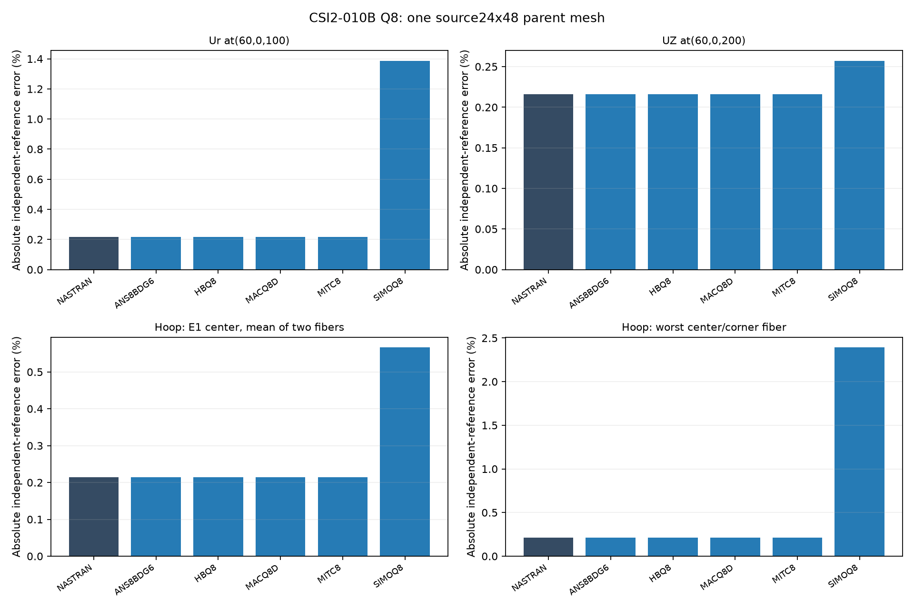
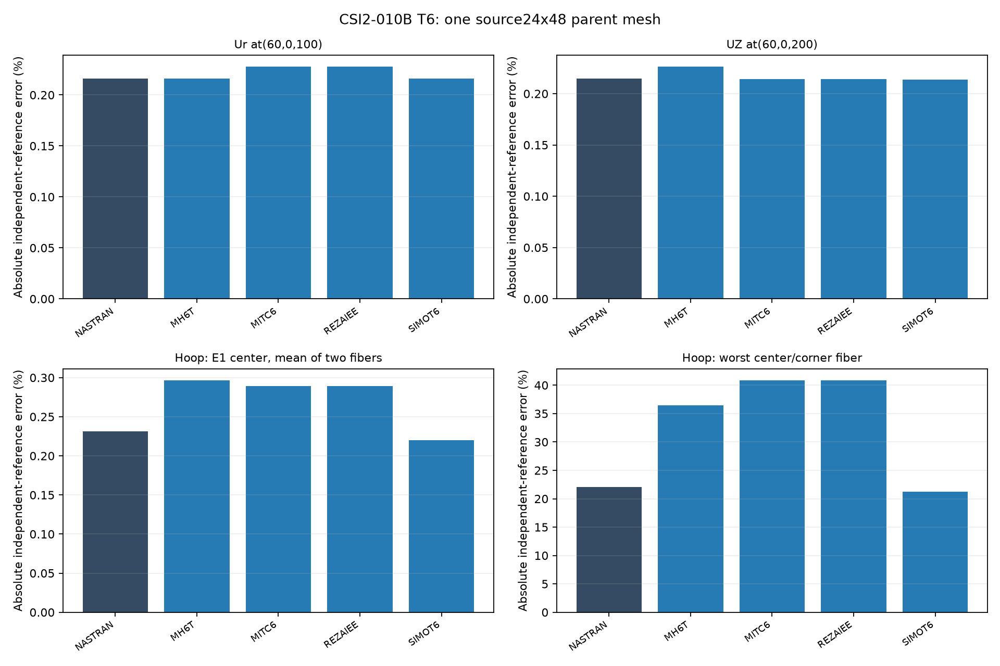
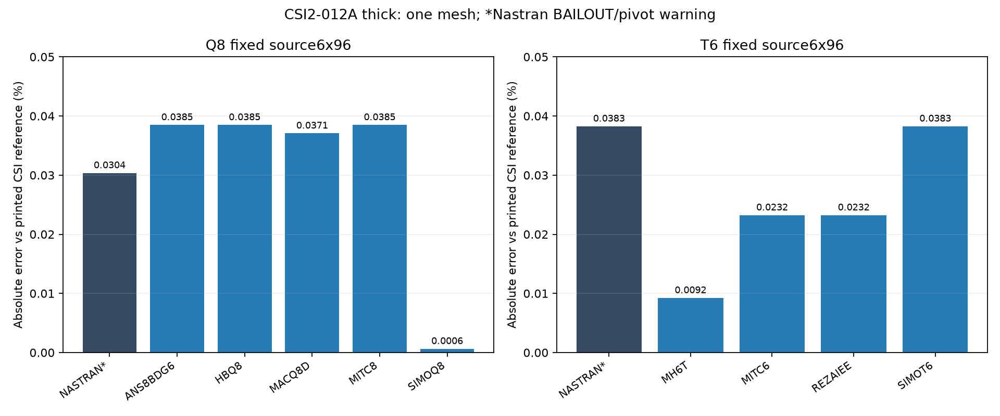

# Quadratic shell benchmark — reference-anchored comparisons

**Ary · Independent Researcher · Personal Research** · Rev 5 · 20 October 2026

> This supersedes the invalid 2-005 A/B plate overlays and older 2-009 unsupported-foundation figures. Includes available published data and diagnostic curves with explicit status.

## Method

- Independent reference is mandatory to claim physical accuracy; present Nastran/reference and MYSTRAN/reference separately.
- For 2-005 use 2×10-in C/D CSI references (12.97, 16.95, 2.60, 7.25 in).
- For 2-008 compute frequencies as `f=1/T`, not CSI period-based percentage errors.
- For 2-014 radial/tangential axes and local shell moments must be audited; one-mesh figures are bar charts.
- For 2-016–2-017 signed buckling eigenvalues are not automatically stress/force; assess prestress baseline, sign, and mode MAC.
- For reference exactly 0, report absolute residual. Preserve missing data and flags; don't interpolate missing mesh runs.
- Distinct markers, line patterns and labels identify different element formulations, even if curves overlap.

## Case index

- [2-001: Membrane/bending patch; pointwise recovery](benchmark_2_001.md) — Joint and element stresses require correct frame; Q8 transverse shear recovery LC2 under review.
- [2-002: Fixed A/Q8 and E/T6 with midpoint BC](benchmark_2_002.md) — Single source mesh each; midpointSPC126, six load cases, bar errors and retained pivot warnings.
- [2-003: Plate/shell validation](benchmark_2_003.md) — Q8 7-mesh full-clamp convergence and 6×1 values; T6 support parity pending.
- [2-004: Fixed-source twisted beam Q8/T6](benchmark_2_004.md) — Source12×2; root midsides clamped, T6 two triangles per quad; tip-load sensitivity bars and explicit MACQ8D SPCF-output failure. No convergence study.
- [2-005: 2×10 in C/D plate quarter convergence](benchmark_2_005.md) — Corrected reference: C uniform 12.97 in; C point 16.95 in; D uniform 2.60 in; D point 7.25 in. T6 point-load under investigation.
- [2-006: Scordelis-Lo roof](benchmark_2_006.md) — Free-edge error bars and seven-point displacement profiles re-exported; moment axes pending.
- [2-007: S2K-based hemispherical shell thick convergence](benchmark_2_007.md) — Complete Q8/T6 native OP2, nx4/8/16/32; independent-reference ratios and errors, 44 matching runs.
- [2-008: Thick plate modal / diagonal CONM2](benchmark_2_008.md) — CSI five independent periods: 0.01723, 0.00704, 0.00281, 0.00219, 0.00193 s; plot f/fref.
- [2-009: Plate on elastic foundation](benchmark_2_009.md) — EXCLUDED invalid older model; foundation A/B stiffness must be corrected and rerun.
- [2-010B: Fixed24×48 pressure cylinder](benchmark_2_010.md) — TargetsUr+0.12414in, topUZ−0.12414in, hoop60ksi; native OLOAD verified; fiber/corner stress nonuniformity explicit.
- [2-012A: Fixed6×96 annulus, thick shear/bending](benchmark_2_012.md) — One source mesh; midpoint inner support and consistent line load; targetUZ−0.00534in. Nastran9137 failures and BAILOUT warnings retained.
- [2-013: Thermal constant through thickness](benchmark_2_013.md) — 2-013A Ux=0.000132, Uy=0.000066 in at joint8; 2-013B sigma_xx=sigma_yy=-733.33 psi, with measured GPSTRESS.
- [2-014: Annular thermal gradient](benchmark_2_014.md) — 9×16 CSI thick reference: Uz=0.01931 in, R2=0.00352 rad, M11=-2.181 and M22=-4.406 kip-in/in; Python-generated 28×32 Q8 / 1792 T6 triangles is not the CSI mesh.
- [2-015: Shell benchmark](benchmark_2_015.md) — Pending independent-reference and run metadata verification.
- [2-016: Out-of-plane buckling](benchmark_2_016.md) — CSI shear/bend references t=1: 425/1165 ksi; t=0.01: 0.0425/0.1165 ksi. Buckling lambda to critical stress requires load normalization, including t=1 provisional.
- [2-017: In-plane buckling](benchmark_2_017.md) — CSI reference Pcr=127.91 kip; lambda requires load basis and physical buckling mode matching.

## Reference tables

| CSI | Output | Independent reference | Units | Qualification / source |
|---|---|---|---|---|
| 2-001 | sigma XX / YY; XY | 1333.333333 / 1333.333333; 400 | psi | Global basic frame; zero quantities use absolute residual; [case](benchmark_2_001.md) |
| 2-002 A/E LC1 | Mean tip Ux | 0.000030 | in | Selected midpoint SPC126; fixed source meshes; [case](benchmark_2_002.md) |
| 2-002 A/E LC2 | Mean tip Uz | 0.1081 | in | Signed mean, joints7 and14; [case](benchmark_2_002.md) |
| 2-002 A/E LC3 | Mean tip Uy | 0.4321 | in | Signed mean, joints7 and14; [case](benchmark_2_002.md) |
| 2-002 A/E LC4 | Mean absolute tip Uy | 0.00341 | in | Twist; [case](benchmark_2_002.md) |
| 2-002 A/E LC5 | Mean absolute tip Ux | 0.000900 | in | In-plane moment; [case](benchmark_2_002.md) |
| 2-002 A/E LC6 | Mean tip Rz | 0.03600 | rad | Out-of-plane moment; [case](benchmark_2_002.md) |
| 2-003 | Mean tip Uy IN / Uz OUT | 0.0886 / 0.5004 | in | Q8 full clamp; T6 support parity pending; alternative OUT0.4546 torsional correction is separate; [case](benchmark_2_003.md) |
| 2-004 | Mean tip Uy IN / Uz OUT | 0.005429 / 0.001749 | in | Original three tip nodes; source-point and quadratic-line loads labelled separately; [case](benchmark_2_004.md) |
| 2-005 C simple uniform | Absolute center Uz | 12.97 | in | Quarter of2×10-in full plate; [case](benchmark_2_005.md) |
| 2-005 C simple point | Absolute center Uz | 16.95 | in | Same geometry; [case](benchmark_2_005.md) |
| 2-005 D fixed uniform | Absolute center Uz | 2.60 | in | Same geometry; [case](benchmark_2_005.md) |
| 2-005 D fixed point | Absolute center Uz | 7.25 | in | Same geometry; [case](benchmark_2_005.md) |
| 2-006 | Free-edge Uz | −0.3086 | ft | Displacement target; moment-axis validation pending; [case](benchmark_2_006.md) |
| 2-007 | Loaded-point Ux / Uy | +0.0940 / −0.0940 | ft | 18-degree opening;0.0924 no-opening lower bound excluded; [case](benchmark_2_007.md) |
| 2-008 | Ordered frequencies1–5 | 58.038305 / 142.045455 / 355.871886 / 456.621005 / 518.134715 | Hz | 1/T from independent periods; mode MAC not verified; [case](benchmark_2_008.md) |
| 2-010B | Radial Ur at(60,0,100) | +0.12414 | in | Printed independent target; exact0.1241379310; fixed24×48 polygon; [case](benchmark_2_010.md) |
| 2-010B | Top Uz at(60,0,200) | −0.12414 | in | Printed independent target; exact−0.1241379310; [case](benchmark_2_010.md) |
| 2-010B | Hoop stress anywhere | 60 | ksi | Pointwise fiber/corner range reported; centroid mean is a separate diagnostic; [case](benchmark_2_010.md) |
| 2-012A thick | Outer-edge Uz at(2,0,0) | −0.00534 | in | Combined bending/shear; fixed6×96; Nastran recovery warnings retained; [case](benchmark_2_012.md) |
| 2-013A | Ux / Uy at joint8 | 0.000132 / 0.000066 | in | Free expansion; zero stress uses absolute residual; [case](benchmark_2_013.md) |
| 2-013B | sigma XX / YY | −733.33 / −733.33 | psi | Rounded reference; GPSTRESS audit; [case](benchmark_2_013.md) |
| 2-014 thick A | Inner Uz / R2 | 0.01931 / 0.00352 | in / rad | CSI9×16 reference; research28×32 mesh distinct; [case](benchmark_2_014.md) |
| 2-014 thick A | Outer M11 / inner M22 | −2.181 / −4.406 | kip-in/in | Local shell axes; [case](benchmark_2_014.md) |
| 2-016 t=1 | Critical shear / normal stress | 425 / 1165 | ksi | Eigenvalue load-basis audit required; [case](benchmark_2_016.md) |
| 2-016 t=.01 | Critical shear / normal stress | 0.0425 / 0.1165 | ksi | Nastran7340 missing output; normalization pending; [case](benchmark_2_016.md) |
| 2-017 | Pcr | 127.91 | kip | Load basis and physical mode verification required; [case](benchmark_2_017.md) |

Targets are independent references, not a blanket PASS. Cases2-009 and2-015 have no verified target admitted here. For2-012, the printed bending−0.00521in and shear−0.000125in are source components, not separately extracted runs.

## Measured figures and status

### CSI 2-010B

[Fixed-source results and recovery audit](benchmark_2_010.md). All11 native OP2 runs completed. Nastran displacement errors are approximately0.216%. T6 fiber/corner hoop recovery is nonuniform; the maximum pointwise error remains visible alongside the centroid diagnostic.

### CSI 2-012A thick

[Fixed-source annulus results](benchmark_2_012.md). One6×96 mesh, simply supported inner edge including midsides. Two strict Nastran failures remain recorded; separate BAILOUT recovery outputs retain pivot warnings.

### CSI 2-005

[Detailed embedded values and audit](benchmark_2_005.md)

### CSI 2-013

[Detailed embedded values and audit](benchmark_2_013.md)

### CSI 2-014

[Detailed embedded values and audit](benchmark_2_014.md)

### CSI 2-008

[Detailed embedded values and audit](benchmark_2_008.md)

### CSI 2-016

[Detailed embedded values and audit](benchmark_2_016.md)

### CSI 2-017

[Detailed embedded values and audit](benchmark_2_017.md)

## Exclusions and open issues

2-009 **EXCLUDED** (incorrect plate size/foundation); original 2-005 invalid A/B graphs **SUPERSEDED**; 2-002 **under review** for restraints/pivots; 2-016 t=.01 **FAILED NASTRAN7340**; native eigenvalue normalization remainsPENDING; 2-017 **reference conversion conditional**. No global ranking of elements is warranted by incomplete benchmarks.

[Quadratic comparison tables (ZIP)](comparison_all.zip) — tables at published precision, with source reports and qualifications.
