# Quadratic shell benchmark — reference-anchored comparisons

**Ary · Independent Researcher · Personal Research** · Rev 4 · 19 October 2026

> This supersedes the invalid 2-005 A/B plate overlays and older 2-009 unsupported-foundation figures. Includes available published data and diagnostic curves with explicit status.

## Method

- Independent reference is mandatory to claim physical accuracy; present Nastran/reference and MYSTRAN/reference separately.
- For 2-005 use 2×10-in C/D CSI references (12.97, 16.95, 2.60, 7.25 in).
- For 2-008 compute frequencies as `f=1/T`, not CSI period-based percentage errors.
- For 2-014 radial/tangential axes and local shell moments must be audited; one-mesh figures are bar charts.
- For 2-016–2-017 signed buckling eigenvalues are not automatically stress/force; assess prestress baseline, sign, and mode MAC.
- For reference exactly 0, report absolute residual. Preserve missing data and flags; don't interpolate missing mesh runs.
- Distinct markers, line patterns and labels identify different element formulations, even if curves overlap.

## Case index

- [2-001: Membrane/bending patch; pointwise recovery](benchmark_2_001.md) — Joint and element stresses require correct frame; Q8 transverse shear recovery LC2 under review.
- [2-002: Fixed A/Q8 and E/T6 with midpoint BC](benchmark_2_002.md) — Single source mesh each; midpointSPC126, six load cases, bar errors and retained pivot warnings.
- [2-003: Plate/shell validation](benchmark_2_003.md) — Q8 7-mesh full-clamp convergence and 6×1 values; T6 support parity pending.
- [2-004: Fixed-source twisted beam Q8/T6](benchmark_2_004.md) — Source12×2; root midsides clamped, T6 two triangles per quad; tip-load sensitivity bars and explicit MACQ8D SPCF-output failure. No convergence study.
- [2-005: 2×10 in C/D plate quarter convergence](benchmark_2_005.md) — Corrected reference: C uniform 12.97 in; C point 16.95 in; D uniform 2.60 in; D point 7.25 in. T6 point-load under investigation.
- [2-006: Scordelis-Lo roof](benchmark_2_006.md) — Free-edge error bars and seven-point displacement profiles re-exported; moment axes pending.
- [2-007: S2K-based hemispherical shell thick convergence](benchmark_2_007.md) — Complete Q8/T6 native OP2, nx4/8/16/32; independent-reference ratios and errors, 44 matching runs.
- [2-008: Thick plate modal / diagonal CONM2](benchmark_2_008.md) — CSI five independent periods: 0.01723, 0.00704, 0.00281, 0.00219, 0.00193 s; plot f/fref.
- [2-009: Plate on elastic foundation](benchmark_2_009.md) — EXCLUDED invalid older model; foundation A/B stiffness must be corrected and rerun.
- [2-010: Shell benchmark](benchmark_2_010.md) — No verified independent-reference figure in consolidated dataset.
- [2-012: Shell benchmark](benchmark_2_012.md) — Do not infer validated reference from solver parity.
- [2-013: Thermal constant through thickness](benchmark_2_013.md) — 2-013A Ux=0.000132, Uy=0.000066 in at joint8; 2-013B sigma_xx=sigma_yy=-733.33 psi, with measured GPSTRESS.
- [2-014: Annular thermal gradient](benchmark_2_014.md) — 9×16 CSI thick reference: Uz=0.01931 in, R2=0.00352 rad, M11=-2.181 and M22=-4.406 kip-in/in; Python-generated 28×32 Q8 / 1792 T6 triangles is not the CSI mesh.
- [2-015: Shell benchmark](benchmark_2_015.md) — Pending independent-reference and run metadata verification.
- [2-016: Out-of-plane buckling](benchmark_2_016.md) — CSI shear/bend references t=1: 425/1165 ksi; t=0.01: 0.0425/0.1165 ksi. Buckling lambda to critical stress requires load normalization, including t=1 provisional.
- [2-017: In-plane buckling](benchmark_2_017.md) — CSI reference Pcr=127.91 kip; lambda requires load basis and physical buckling mode matching.

## Reference tables

| CSI | Output | Independent reference | Units | Qualification |
|---|---|---:|---|---|
| 2-005 C simple uniform | center Uz absolute | 12.97 | in | quarter model 2×10 full plate |
| 2-005 C simple point | center Uz absolute | 16.95 | in | same |
| 2-005 D fixed uniform | center Uz absolute | 2.60 | in | same |
| 2-005 D fixed point | center Uz absolute | 7.25 | in | same |
| 2-013 A | Ux/Uy joint 8 | 0.000132 / 0.000066 | in | free expansion |
| 2-013 B | sigma_xx/sigma_yy joint 8 | −733.33 / −733.33 | psi | restrained; OGS audit |
| 2-014 thick A | Uz / R2 inner | 0.01931 / 0.00352 | in / rad | inner boundary |
| 2-014 thick A | M11 outer / M22 inner | −2.181 / −4.406 | kip-in/in | local axes |
| 2-016, t=1 | tau_cr / sigma_cr | 425 / 1165 | ksi | load-basis audit before lambda overlay |
| 2-016, t=.01 | tau_cr / sigma_cr | 0.0425 / 0.1165 | ksi | source Nastran missing |
| 2-017 | Pcr | 127.91 | kip | reference vs eigenvalue needs load basis |

## Measured figures and status

### CSI 2-005

[Detailed embedded values and audit](benchmark_2_005.md)

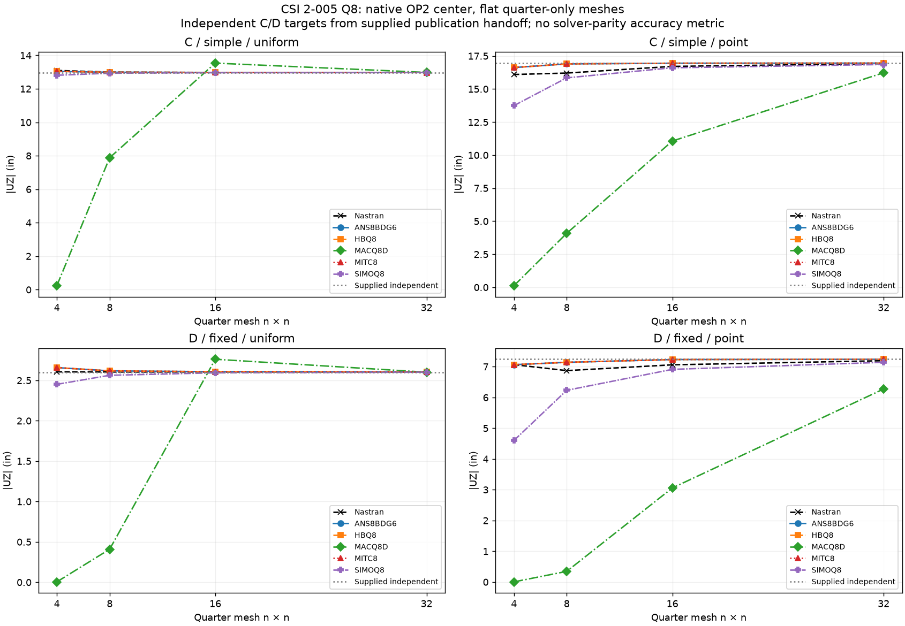

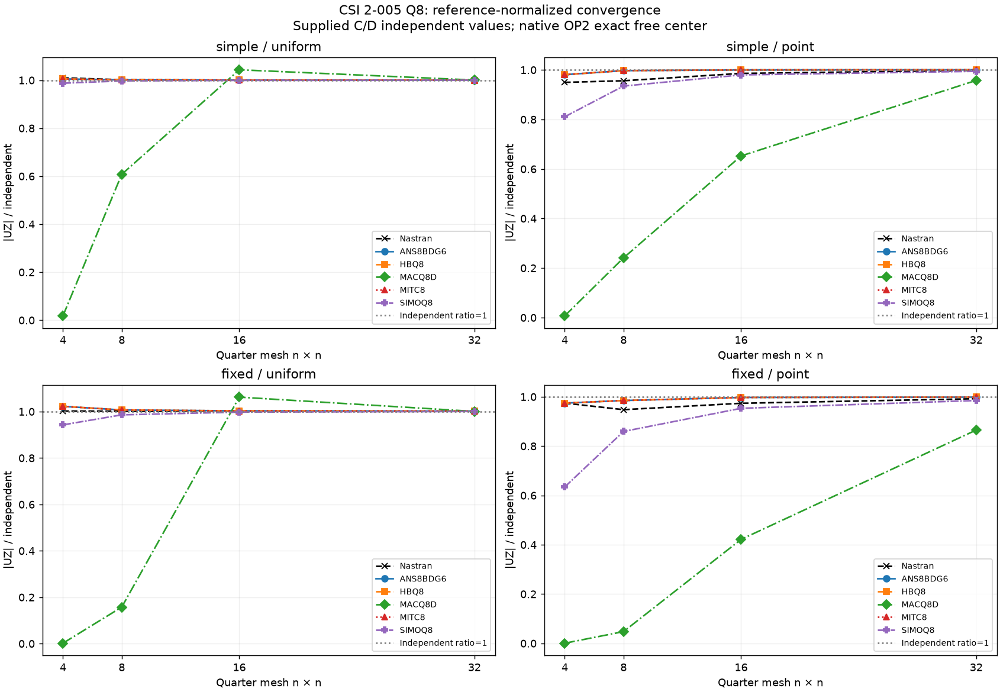

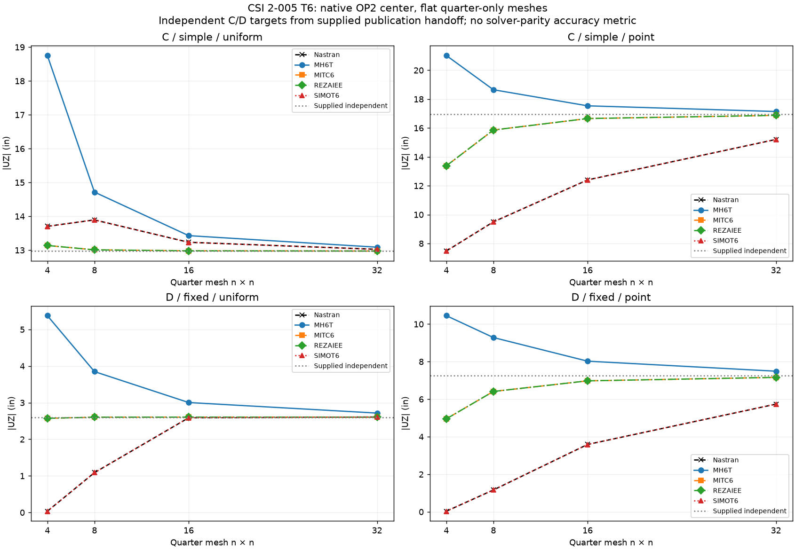

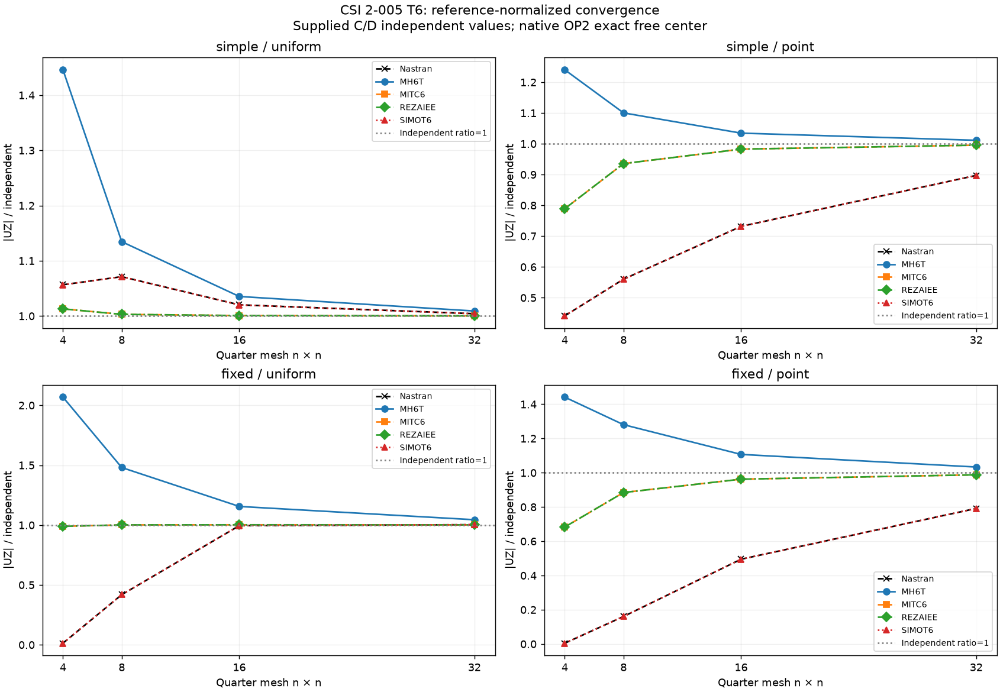

### CSI 2-013

[Detailed embedded values and audit](benchmark_2_013.md)

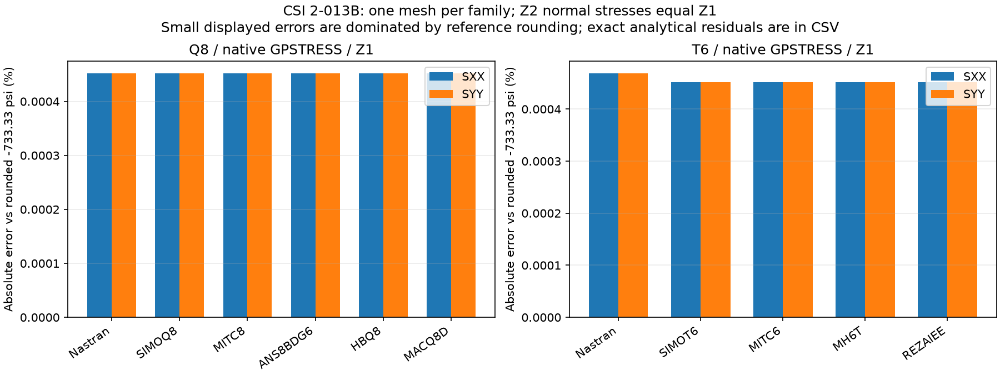

### CSI 2-014

[Detailed embedded values and audit](benchmark_2_014.md)

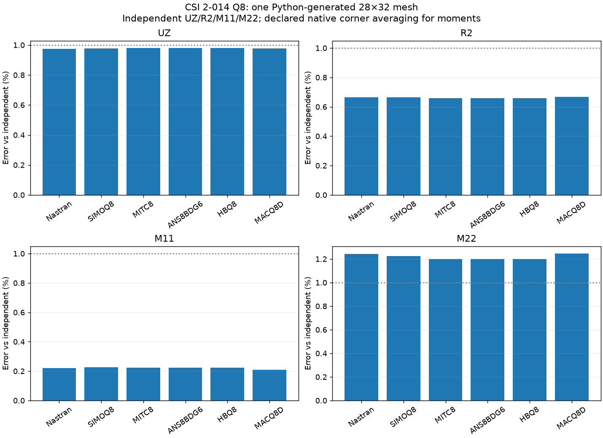

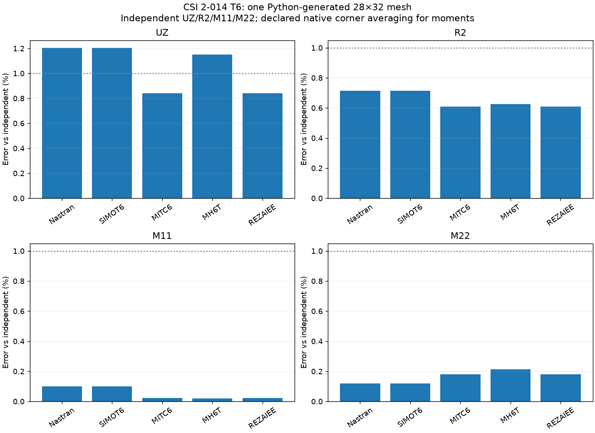

### CSI 2-008

[Detailed embedded values and audit](benchmark_2_008.md)

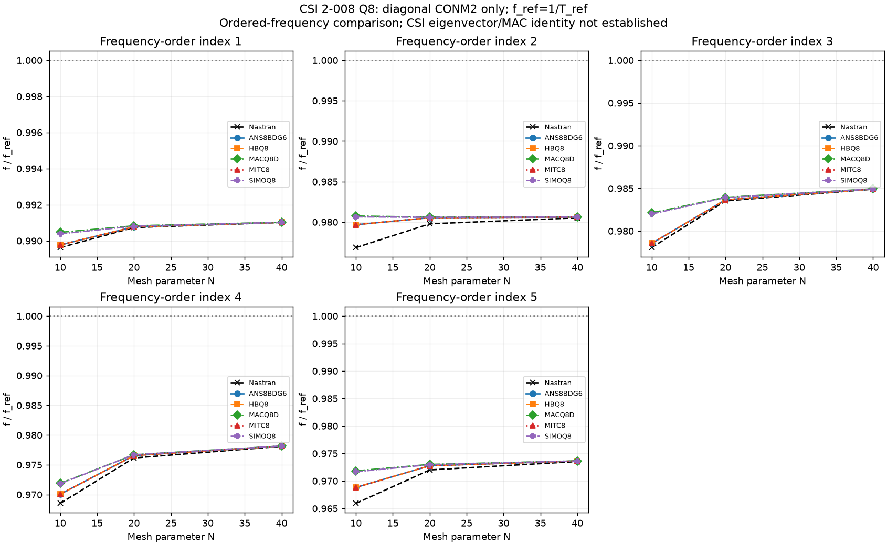

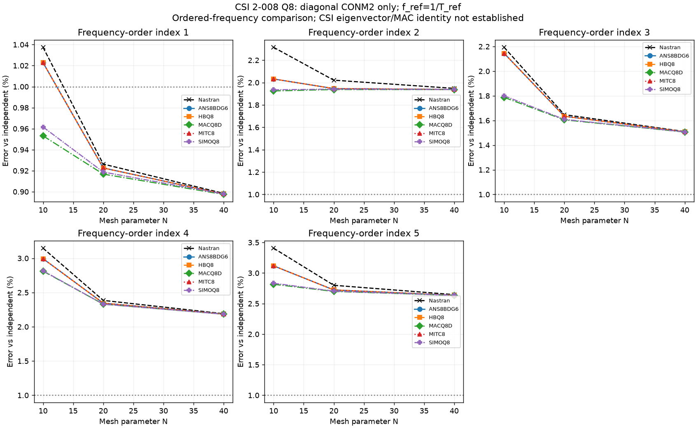

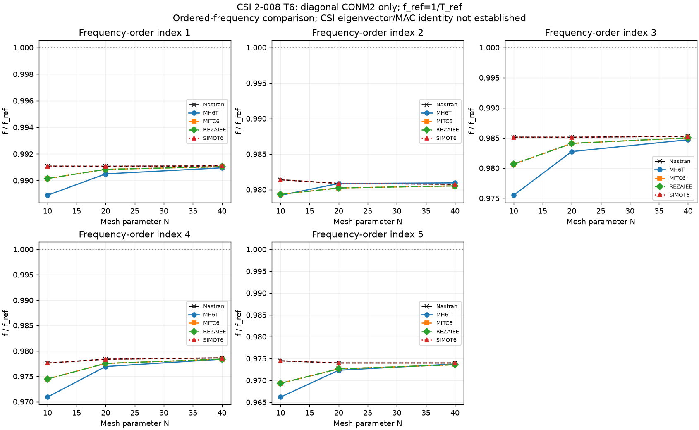

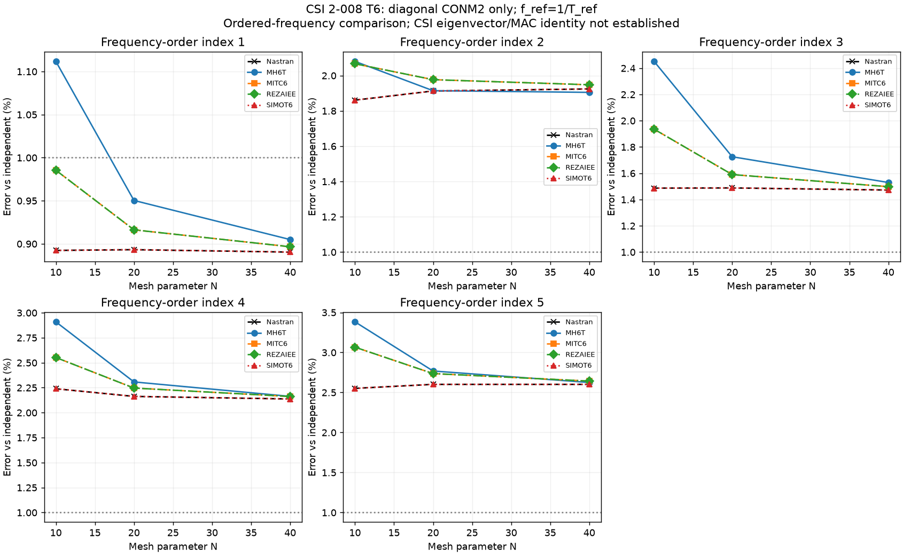

### CSI 2-016

[Detailed embedded values and audit](benchmark_2_016.md)

### CSI 2-017

[Detailed embedded values and audit](benchmark_2_017.md)

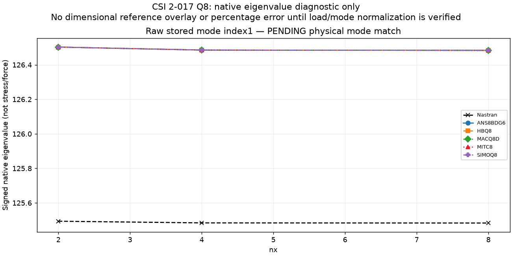

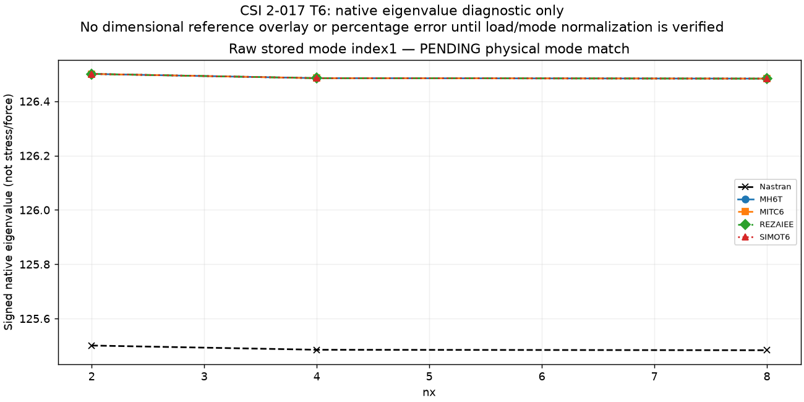

## Exclusions and open issues

2-009 **EXCLUDED** (incorrect plate size/foundation); original 2-005 invalid A/B graphs **SUPERSEDED**; 2-002 **under review** for restraints/pivots; 2-016 t=.01 **FAILED NASTRAN7340**; native eigenvalue normalization remainsPENDING; 2-017 **reference conversion conditional**. No global ranking of elements is warranted by incomplete benchmarks.
