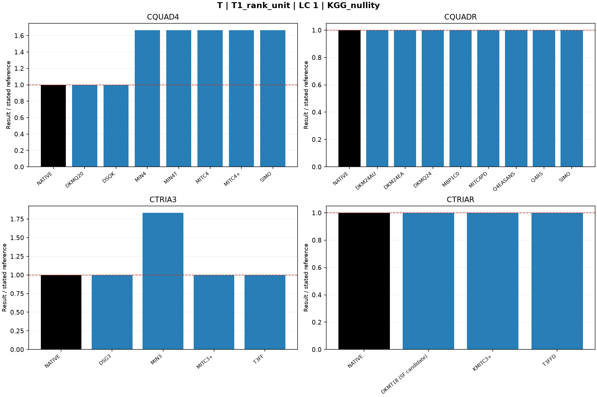
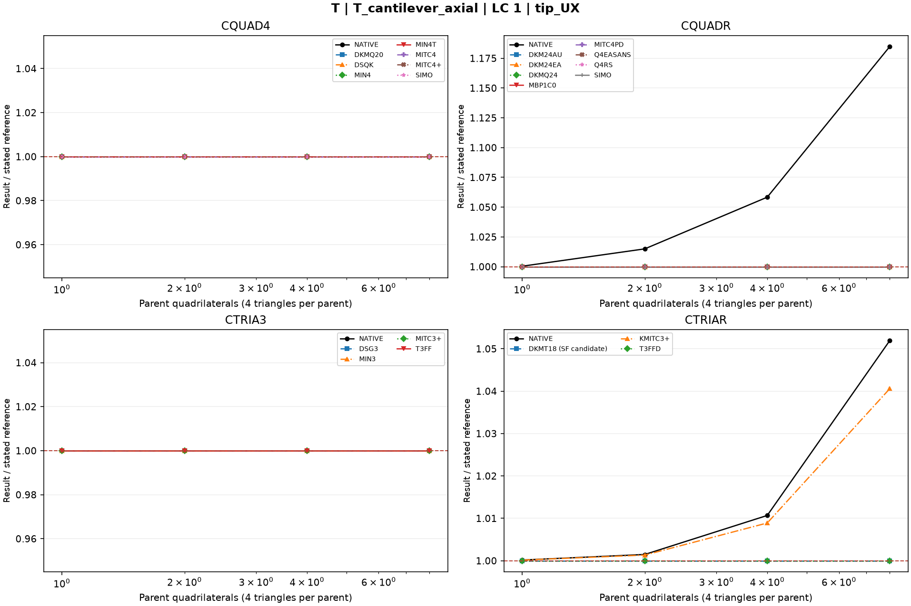
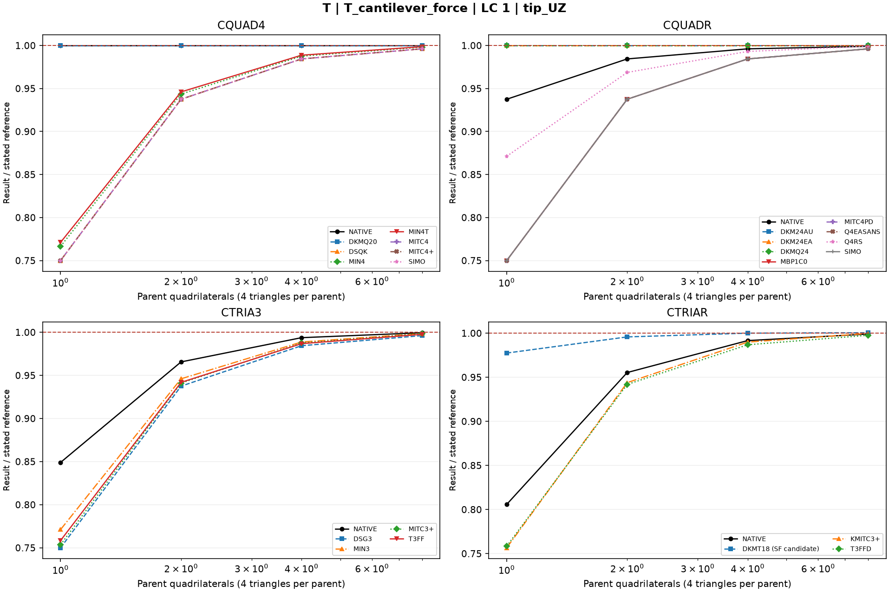
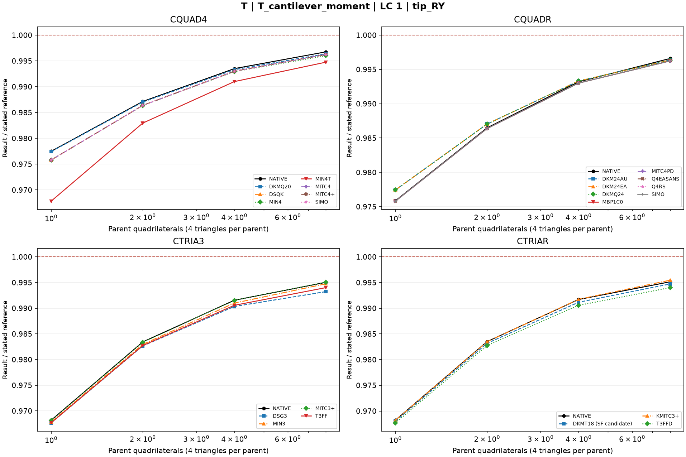
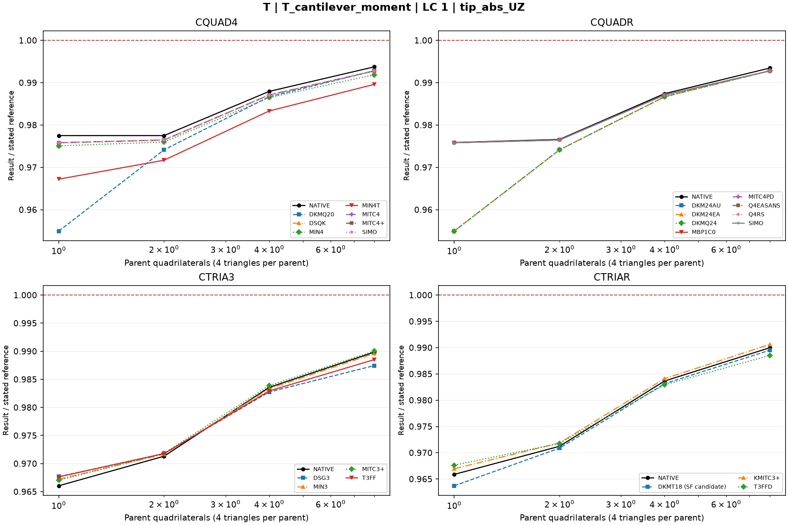
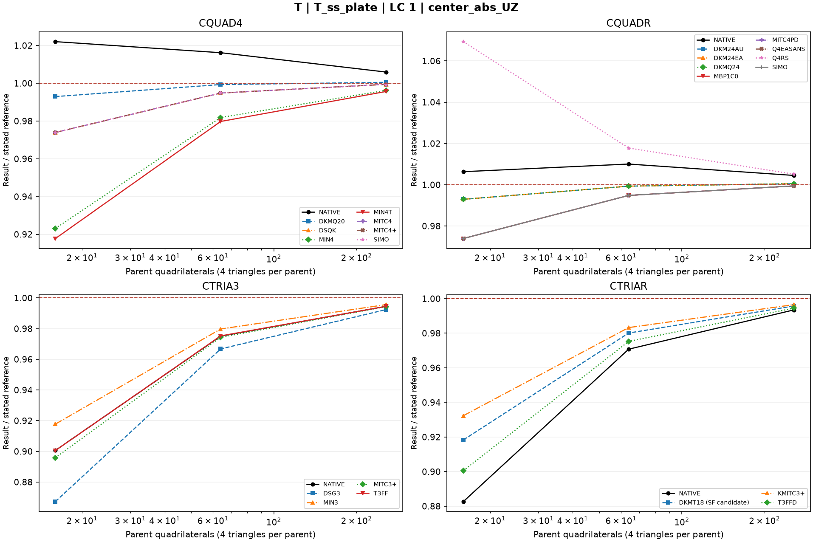

# Linear shells — T: Rank and supplementary analytical tests

25 October 2026. Fresh native MYSTRAN and Nastran runs. CQUAD4, CQUADR, CTRIA3 and CTRIAR only.

[All linear comparisons](comparison_all_linear.md) · [Full ZIP](comparison_all_linear.zip) · [Tested DAT](DAT/linear_shell_benchmark_DAT.zip) · [Linear publication QA](PUBLICATION_QA_linear.md)

Case IDs retain source-model filenames; actual element and formulation are given by their columns and deck selectors. Two-axis 2-002 tip observables use the two physical corner nodes.

NATIVE means the Nastran result for the corresponding element card: CQUAD4, CQUADR, CTRIA3 or CTRIAR. It does not mean the same proprietary interpolation as a MYSTRAN selector. Curves use independent/analytical references; published SAP2000 values are separate table columns. A completed solve is not a physical-accuracy pass. Zero references use absolute residuals; missing and failed output is never replaced by zero.

The tested source snapshot includes DKMT18 SF as an explicitly labelled candidate and corrected DSG3 local-z Kg. It is documented in [source provenance](data_linear/provenance_linear.json), with a reproducible element-local patch. This benchmark snapshot is not a declaration that SF passed every production-promotion gate. No shared eigensolver prototype is included.

## Model and comparison scope

Reference Python T-series parameters retained. Rank uses exported physical KGG, not a count of low dynamic frequencies. Cantilever moment/force/axial and simply supported plate provide additional analytical checks.

Rank nullity uses native double KGG for MYSTRAN and unit-displacement SPC-reaction reconstruction for Nastran. Nullity alone does not establish the physical rigid-body nullspace; original formulation stabilization limitations remain.

## Extraction status

| Solver | Status | Metric rows |
|---|---|---:|
| MYSTRAN | MEASURED | 550 |
| NASTRAN | MEASURED | 100 |

## Figures

### T1_rank_distorted · LC 1 · KGG_nullity

### T1_rank_unit · LC 1 · KGG_nullity

### T_cantilever_axial · LC 1 · tip_UX

### T_cantilever_force · LC 1 · tip_UZ

### T_cantilever_moment · LC 1 · tip_RY

### T_cantilever_moment · LC 1 · tip_abs_UZ

### T_ss_plate · LC 1 · center_abs_UZ

## Finest available mesh per named series

| Case / parent quads | Solver / formulation | LC | Quantity | Measured | Independent / analytical | CSI published | Unit | Error % primary | Absolute residual | Status |
|---|---|---:|---|---:|---:|---:|---|---:|---:|---|
| T1_rank_distorted / 1 | MYSTRAN CQUAD4_DKMQ20 | 1 | KGG_negative_eigenvalues | 0 | 0 | — | count | — | 0 | MEASURED |
| T1_rank_distorted / 1 | MYSTRAN CQUAD4_DSQK | 1 | KGG_negative_eigenvalues | 0 | 0 | — | count | — | 0 | MEASURED |
| T1_rank_distorted / 1 | MYSTRAN CQUAD4_MIN4 | 1 | KGG_negative_eigenvalues | 0 | 0 | — | count | — | 0 | MEASURED |
| T1_rank_distorted / 1 | MYSTRAN CQUAD4_MIN4T | 1 | KGG_negative_eigenvalues | 0 | 0 | — | count | — | 0 | MEASURED |
| T1_rank_distorted / 1 | MYSTRAN CQUAD4_MITC4 | 1 | KGG_negative_eigenvalues | 0 | 0 | — | count | — | 0 | MEASURED |
| T1_rank_distorted / 1 | MYSTRAN CQUAD4_MITC4plus | 1 | KGG_negative_eigenvalues | 0 | 0 | — | count | — | 0 | MEASURED |
| T1_rank_distorted / 1 | MYSTRAN CQUAD4_SIMO | 1 | KGG_negative_eigenvalues | 0 | 0 | — | count | — | 0 | MEASURED |
| T1_rank_distorted / 1 | MYSTRAN CQUADR_DKM24AU | 1 | KGG_negative_eigenvalues | 0 | 0 | — | count | — | 0 | MEASURED |
| T1_rank_distorted / 1 | MYSTRAN CQUADR_DKM24EA | 1 | KGG_negative_eigenvalues | 0 | 0 | — | count | — | 0 | MEASURED |
| T1_rank_distorted / 1 | MYSTRAN CQUADR_DKMQ24 | 1 | KGG_negative_eigenvalues | 0 | 0 | — | count | — | 0 | MEASURED |
| T1_rank_distorted / 1 | MYSTRAN CQUADR_MBP1C0 | 1 | KGG_negative_eigenvalues | 0 | 0 | — | count | — | 0 | MEASURED |
| T1_rank_distorted / 1 | MYSTRAN CQUADR_MITC4PD | 1 | KGG_negative_eigenvalues | 0 | 0 | — | count | — | 0 | MEASURED |
| T1_rank_distorted / 1 | MYSTRAN CQUADR_Q4EASANS | 1 | KGG_negative_eigenvalues | 0 | 0 | — | count | — | 0 | MEASURED |
| T1_rank_distorted / 1 | MYSTRAN CQUADR_Q4RS | 1 | KGG_negative_eigenvalues | 0 | 0 | — | count | — | 0 | MEASURED |
| T1_rank_distorted / 1 | MYSTRAN CQUADR_SIMO | 1 | KGG_negative_eigenvalues | 0 | 0 | — | count | — | 0 | MEASURED |
| T1_rank_distorted / 1 | MYSTRAN CTRIA3_DSG3 | 1 | KGG_negative_eigenvalues | 0 | 0 | — | count | — | 0 | MEASURED |
| T1_rank_distorted / 1 | MYSTRAN CTRIA3_MIN3 | 1 | KGG_negative_eigenvalues | 0 | 0 | — | count | — | 0 | MEASURED |
| T1_rank_distorted / 1 | MYSTRAN CTRIA3_MITC3plus | 1 | KGG_negative_eigenvalues | 0 | 0 | — | count | — | 0 | MEASURED |
| T1_rank_distorted / 1 | MYSTRAN CTRIA3_T3FF | 1 | KGG_negative_eigenvalues | 0 | 0 | — | count | — | 0 | MEASURED |
| T1_rank_distorted / 1 | MYSTRAN CTRIAR_DKMT18 (SF candidate) | 1 | KGG_negative_eigenvalues | 0 | 0 | — | count | — | 0 | MEASURED |
| T1_rank_distorted / 1 | MYSTRAN CTRIAR_KMITC3plus | 1 | KGG_negative_eigenvalues | 0 | 0 | — | count | — | 0 | MEASURED |
| T1_rank_distorted / 1 | MYSTRAN CTRIAR_T3FFD | 1 | KGG_negative_eigenvalues | 0 | 0 | — | count | — | 0 | MEASURED |
| T1_rank_distorted / 1 | NASTRAN CQUAD4_NATIVE | 1 | KGG_negative_eigenvalues | 1 | 0 | — | count | — | 1 | MEASURED |
| T1_rank_distorted / 1 | NASTRAN CQUADR_NATIVE | 1 | KGG_negative_eigenvalues | 0 | 0 | — | count | — | 0 | MEASURED |
| T1_rank_distorted / 1 | NASTRAN CTRIA3_NATIVE | 1 | KGG_negative_eigenvalues | 0 | 0 | — | count | — | 0 | MEASURED |
| T1_rank_distorted / 1 | NASTRAN CTRIAR_NATIVE | 1 | KGG_negative_eigenvalues | 0 | 0 | — | count | — | 0 | MEASURED |
| T1_rank_distorted / 1 | MYSTRAN CQUAD4_DKMQ20 | 1 | KGG_nullity | 6 | 6 | — | DOF | 0 | 0 | MEASURED |
| T1_rank_distorted / 1 | MYSTRAN CQUAD4_DSQK | 1 | KGG_nullity | 6 | 6 | — | DOF | 0 | 0 | MEASURED |
| T1_rank_distorted / 1 | MYSTRAN CQUAD4_MIN4 | 1 | KGG_nullity | 10 | 6 | — | DOF | 66.66667 | 4 | MEASURED |
| T1_rank_distorted / 1 | MYSTRAN CQUAD4_MIN4T | 1 | KGG_nullity | 10 | 6 | — | DOF | 66.66667 | 4 | MEASURED |
| T1_rank_distorted / 1 | MYSTRAN CQUAD4_MITC4 | 1 | KGG_nullity | 10 | 6 | — | DOF | 66.66667 | 4 | MEASURED |
| T1_rank_distorted / 1 | MYSTRAN CQUAD4_MITC4plus | 1 | KGG_nullity | 10 | 6 | — | DOF | 66.66667 | 4 | MEASURED |
| T1_rank_distorted / 1 | MYSTRAN CQUAD4_SIMO | 1 | KGG_nullity | 10 | 6 | — | DOF | 66.66667 | 4 | MEASURED |
| T1_rank_distorted / 1 | MYSTRAN CQUADR_DKM24AU | 1 | KGG_nullity | 6 | 6 | — | DOF | 0 | 0 | MEASURED |
| T1_rank_distorted / 1 | MYSTRAN CQUADR_DKM24EA | 1 | KGG_nullity | 6 | 6 | — | DOF | 0 | 0 | MEASURED |
| T1_rank_distorted / 1 | MYSTRAN CQUADR_DKMQ24 | 1 | KGG_nullity | 6 | 6 | — | DOF | 0 | 0 | MEASURED |
| T1_rank_distorted / 1 | MYSTRAN CQUADR_MBP1C0 | 1 | KGG_nullity | 6 | 6 | — | DOF | 0 | 0 | MEASURED |
| T1_rank_distorted / 1 | MYSTRAN CQUADR_MITC4PD | 1 | KGG_nullity | 6 | 6 | — | DOF | 0 | 0 | MEASURED |
| T1_rank_distorted / 1 | MYSTRAN CQUADR_Q4EASANS | 1 | KGG_nullity | 6 | 6 | — | DOF | 0 | 0 | MEASURED |
| T1_rank_distorted / 1 | MYSTRAN CQUADR_Q4RS | 1 | KGG_nullity | 6 | 6 | — | DOF | 0 | 0 | MEASURED |
| T1_rank_distorted / 1 | MYSTRAN CQUADR_SIMO | 1 | KGG_nullity | 6 | 6 | — | DOF | 0 | 0 | MEASURED |
| T1_rank_distorted / 1 | MYSTRAN CTRIA3_DSG3 | 1 | KGG_nullity | 6 | 6 | — | DOF | 0 | 0 | MEASURED |
| T1_rank_distorted / 1 | MYSTRAN CTRIA3_MIN3 | 1 | KGG_nullity | 11 | 6 | — | DOF | 83.33333 | 5 | MEASURED |
| T1_rank_distorted / 1 | MYSTRAN CTRIA3_MITC3plus | 1 | KGG_nullity | 6 | 6 | — | DOF | 0 | 0 | MEASURED |
| T1_rank_distorted / 1 | MYSTRAN CTRIA3_T3FF | 1 | KGG_nullity | 6 | 6 | — | DOF | 0 | 0 | MEASURED |
| T1_rank_distorted / 1 | MYSTRAN CTRIAR_DKMT18 (SF candidate) | 1 | KGG_nullity | 6 | 6 | — | DOF | 0 | 0 | MEASURED |
| T1_rank_distorted / 1 | MYSTRAN CTRIAR_KMITC3plus | 1 | KGG_nullity | 6 | 6 | — | DOF | 0 | 0 | MEASURED |
| T1_rank_distorted / 1 | MYSTRAN CTRIAR_T3FFD | 1 | KGG_nullity | 6 | 6 | — | DOF | 0 | 0 | MEASURED |
| T1_rank_distorted / 1 | NASTRAN CQUAD4_NATIVE | 1 | KGG_nullity | 5 | 6 | — | DOF | 16.66667 | 1 | MEASURED |
| T1_rank_distorted / 1 | NASTRAN CQUADR_NATIVE | 1 | KGG_nullity | 6 | 6 | — | DOF | 0 | 0 | MEASURED |
| T1_rank_distorted / 1 | NASTRAN CTRIA3_NATIVE | 1 | KGG_nullity | 6 | 6 | — | DOF | 0 | 0 | MEASURED |
| T1_rank_distorted / 1 | NASTRAN CTRIAR_NATIVE | 1 | KGG_nullity | 6 | 6 | — | DOF | 0 | 0 | MEASURED |
| T1_rank_distorted / 1 | MYSTRAN CQUAD4_DKMQ20 | 1 | KGG_relative_asymmetry | 0 | 0 | — | dimensionless | — | 0 | MEASURED |
| T1_rank_distorted / 1 | MYSTRAN CQUAD4_DSQK | 1 | KGG_relative_asymmetry | 0 | 0 | — | dimensionless | — | 0 | MEASURED |
| T1_rank_distorted / 1 | MYSTRAN CQUAD4_MIN4 | 1 | KGG_relative_asymmetry | 0 | 0 | — | dimensionless | — | 0 | MEASURED |
| T1_rank_distorted / 1 | MYSTRAN CQUAD4_MIN4T | 1 | KGG_relative_asymmetry | 0 | 0 | — | dimensionless | — | 0 | MEASURED |
| T1_rank_distorted / 1 | MYSTRAN CQUAD4_MITC4 | 1 | KGG_relative_asymmetry | 0 | 0 | — | dimensionless | — | 0 | MEASURED |
| T1_rank_distorted / 1 | MYSTRAN CQUAD4_MITC4plus | 1 | KGG_relative_asymmetry | 0 | 0 | — | dimensionless | — | 0 | MEASURED |
| T1_rank_distorted / 1 | MYSTRAN CQUAD4_SIMO | 1 | KGG_relative_asymmetry | 0 | 0 | — | dimensionless | — | 0 | MEASURED |
| T1_rank_distorted / 1 | MYSTRAN CQUADR_DKM24AU | 1 | KGG_relative_asymmetry | 0 | 0 | — | dimensionless | — | 0 | MEASURED |
| T1_rank_distorted / 1 | MYSTRAN CQUADR_DKM24EA | 1 | KGG_relative_asymmetry | 0 | 0 | — | dimensionless | — | 0 | MEASURED |
| T1_rank_distorted / 1 | MYSTRAN CQUADR_DKMQ24 | 1 | KGG_relative_asymmetry | 0 | 0 | — | dimensionless | — | 0 | MEASURED |
| T1_rank_distorted / 1 | MYSTRAN CQUADR_MBP1C0 | 1 | KGG_relative_asymmetry | 0 | 0 | — | dimensionless | — | 0 | MEASURED |
| T1_rank_distorted / 1 | MYSTRAN CQUADR_MITC4PD | 1 | KGG_relative_asymmetry | 0 | 0 | — | dimensionless | — | 0 | MEASURED |
| T1_rank_distorted / 1 | MYSTRAN CQUADR_Q4EASANS | 1 | KGG_relative_asymmetry | 0 | 0 | — | dimensionless | — | 0 | MEASURED |
| T1_rank_distorted / 1 | MYSTRAN CQUADR_Q4RS | 1 | KGG_relative_asymmetry | 0 | 0 | — | dimensionless | — | 0 | MEASURED |
| T1_rank_distorted / 1 | MYSTRAN CQUADR_SIMO | 1 | KGG_relative_asymmetry | 0 | 0 | — | dimensionless | — | 0 | MEASURED |
| T1_rank_distorted / 1 | MYSTRAN CTRIA3_DSG3 | 1 | KGG_relative_asymmetry | 0 | 0 | — | dimensionless | — | 0 | MEASURED |
| T1_rank_distorted / 1 | MYSTRAN CTRIA3_MIN3 | 1 | KGG_relative_asymmetry | 0 | 0 | — | dimensionless | — | 0 | MEASURED |
| T1_rank_distorted / 1 | MYSTRAN CTRIA3_MITC3plus | 1 | KGG_relative_asymmetry | 0 | 0 | — | dimensionless | — | 0 | MEASURED |
| T1_rank_distorted / 1 | MYSTRAN CTRIA3_T3FF | 1 | KGG_relative_asymmetry | 0 | 0 | — | dimensionless | — | 0 | MEASURED |
| T1_rank_distorted / 1 | MYSTRAN CTRIAR_DKMT18 (SF candidate) | 1 | KGG_relative_asymmetry | 0 | 0 | — | dimensionless | — | 0 | MEASURED |
| T1_rank_distorted / 1 | MYSTRAN CTRIAR_KMITC3plus | 1 | KGG_relative_asymmetry | 0 | 0 | — | dimensionless | — | 0 | MEASURED |
| T1_rank_distorted / 1 | MYSTRAN CTRIAR_T3FFD | 1 | KGG_relative_asymmetry | 0 | 0 | — | dimensionless | — | 0 | MEASURED |
| T1_rank_distorted / 1 | NASTRAN CQUAD4_NATIVE | 1 | KGG_relative_asymmetry | 0 | 0 | — | dimensionless | — | 0 | MEASURED |
| T1_rank_distorted / 1 | NASTRAN CQUADR_NATIVE | 1 | KGG_relative_asymmetry | 0 | 0 | — | dimensionless | — | 0 | MEASURED |
| T1_rank_distorted / 1 | NASTRAN CTRIA3_NATIVE | 1 | KGG_relative_asymmetry | 0 | 0 | — | dimensionless | — | 0 | MEASURED |
| T1_rank_distorted / 1 | NASTRAN CTRIAR_NATIVE | 1 | KGG_relative_asymmetry | 0 | 0 | — | dimensionless | — | 0 | MEASURED |
| T1_rank_unit / 1 | MYSTRAN CQUAD4_DKMQ20 | 1 | KGG_negative_eigenvalues | 0 | 0 | — | count | — | 0 | MEASURED |
| T1_rank_unit / 1 | MYSTRAN CQUAD4_DSQK | 1 | KGG_negative_eigenvalues | 0 | 0 | — | count | — | 0 | MEASURED |
| T1_rank_unit / 1 | MYSTRAN CQUAD4_MIN4 | 1 | KGG_negative_eigenvalues | 0 | 0 | — | count | — | 0 | MEASURED |
| T1_rank_unit / 1 | MYSTRAN CQUAD4_MIN4T | 1 | KGG_negative_eigenvalues | 0 | 0 | — | count | — | 0 | MEASURED |
| T1_rank_unit / 1 | MYSTRAN CQUAD4_MITC4 | 1 | KGG_negative_eigenvalues | 0 | 0 | — | count | — | 0 | MEASURED |
| T1_rank_unit / 1 | MYSTRAN CQUAD4_MITC4plus | 1 | KGG_negative_eigenvalues | 0 | 0 | — | count | — | 0 | MEASURED |
| T1_rank_unit / 1 | MYSTRAN CQUAD4_SIMO | 1 | KGG_negative_eigenvalues | 0 | 0 | — | count | — | 0 | MEASURED |
| T1_rank_unit / 1 | MYSTRAN CQUADR_DKM24AU | 1 | KGG_negative_eigenvalues | 0 | 0 | — | count | — | 0 | MEASURED |
| T1_rank_unit / 1 | MYSTRAN CQUADR_DKM24EA | 1 | KGG_negative_eigenvalues | 0 | 0 | — | count | — | 0 | MEASURED |
| T1_rank_unit / 1 | MYSTRAN CQUADR_DKMQ24 | 1 | KGG_negative_eigenvalues | 0 | 0 | — | count | — | 0 | MEASURED |
| T1_rank_unit / 1 | MYSTRAN CQUADR_MBP1C0 | 1 | KGG_negative_eigenvalues | 0 | 0 | — | count | — | 0 | MEASURED |
| T1_rank_unit / 1 | MYSTRAN CQUADR_MITC4PD | 1 | KGG_negative_eigenvalues | 0 | 0 | — | count | — | 0 | MEASURED |
| T1_rank_unit / 1 | MYSTRAN CQUADR_Q4EASANS | 1 | KGG_negative_eigenvalues | 0 | 0 | — | count | — | 0 | MEASURED |
| T1_rank_unit / 1 | MYSTRAN CQUADR_Q4RS | 1 | KGG_negative_eigenvalues | 0 | 0 | — | count | — | 0 | MEASURED |
| T1_rank_unit / 1 | MYSTRAN CQUADR_SIMO | 1 | KGG_negative_eigenvalues | 0 | 0 | — | count | — | 0 | MEASURED |
| T1_rank_unit / 1 | MYSTRAN CTRIA3_DSG3 | 1 | KGG_negative_eigenvalues | 0 | 0 | — | count | — | 0 | MEASURED |
| T1_rank_unit / 1 | MYSTRAN CTRIA3_MIN3 | 1 | KGG_negative_eigenvalues | 0 | 0 | — | count | — | 0 | MEASURED |
| T1_rank_unit / 1 | MYSTRAN CTRIA3_MITC3plus | 1 | KGG_negative_eigenvalues | 0 | 0 | — | count | — | 0 | MEASURED |
| T1_rank_unit / 1 | MYSTRAN CTRIA3_T3FF | 1 | KGG_negative_eigenvalues | 0 | 0 | — | count | — | 0 | MEASURED |
| T1_rank_unit / 1 | MYSTRAN CTRIAR_DKMT18 (SF candidate) | 1 | KGG_negative_eigenvalues | 0 | 0 | — | count | — | 0 | MEASURED |
| T1_rank_unit / 1 | MYSTRAN CTRIAR_KMITC3plus | 1 | KGG_negative_eigenvalues | 0 | 0 | — | count | — | 0 | MEASURED |
| T1_rank_unit / 1 | MYSTRAN CTRIAR_T3FFD | 1 | KGG_negative_eigenvalues | 0 | 0 | — | count | — | 0 | MEASURED |
| T1_rank_unit / 1 | NASTRAN CQUAD4_NATIVE | 1 | KGG_negative_eigenvalues | 0 | 0 | — | count | — | 0 | MEASURED |
| T1_rank_unit / 1 | NASTRAN CQUADR_NATIVE | 1 | KGG_negative_eigenvalues | 0 | 0 | — | count | — | 0 | MEASURED |
| T1_rank_unit / 1 | NASTRAN CTRIA3_NATIVE | 1 | KGG_negative_eigenvalues | 0 | 0 | — | count | — | 0 | MEASURED |
| T1_rank_unit / 1 | NASTRAN CTRIAR_NATIVE | 1 | KGG_negative_eigenvalues | 0 | 0 | — | count | — | 0 | MEASURED |
| T1_rank_unit / 1 | MYSTRAN CQUAD4_DKMQ20 | 1 | KGG_nullity | 6 | 6 | — | DOF | 0 | 0 | MEASURED |
| T1_rank_unit / 1 | MYSTRAN CQUAD4_DSQK | 1 | KGG_nullity | 6 | 6 | — | DOF | 0 | 0 | MEASURED |
| T1_rank_unit / 1 | MYSTRAN CQUAD4_MIN4 | 1 | KGG_nullity | 10 | 6 | — | DOF | 66.66667 | 4 | MEASURED |
| T1_rank_unit / 1 | MYSTRAN CQUAD4_MIN4T | 1 | KGG_nullity | 10 | 6 | — | DOF | 66.66667 | 4 | MEASURED |
| T1_rank_unit / 1 | MYSTRAN CQUAD4_MITC4 | 1 | KGG_nullity | 10 | 6 | — | DOF | 66.66667 | 4 | MEASURED |
| T1_rank_unit / 1 | MYSTRAN CQUAD4_MITC4plus | 1 | KGG_nullity | 10 | 6 | — | DOF | 66.66667 | 4 | MEASURED |
| T1_rank_unit / 1 | MYSTRAN CQUAD4_SIMO | 1 | KGG_nullity | 10 | 6 | — | DOF | 66.66667 | 4 | MEASURED |
| T1_rank_unit / 1 | MYSTRAN CQUADR_DKM24AU | 1 | KGG_nullity | 6 | 6 | — | DOF | 0 | 0 | MEASURED |
| T1_rank_unit / 1 | MYSTRAN CQUADR_DKM24EA | 1 | KGG_nullity | 6 | 6 | — | DOF | 0 | 0 | MEASURED |
| T1_rank_unit / 1 | MYSTRAN CQUADR_DKMQ24 | 1 | KGG_nullity | 6 | 6 | — | DOF | 0 | 0 | MEASURED |
| T1_rank_unit / 1 | MYSTRAN CQUADR_MBP1C0 | 1 | KGG_nullity | 6 | 6 | — | DOF | 0 | 0 | MEASURED |
| T1_rank_unit / 1 | MYSTRAN CQUADR_MITC4PD | 1 | KGG_nullity | 6 | 6 | — | DOF | 0 | 0 | MEASURED |
| T1_rank_unit / 1 | MYSTRAN CQUADR_Q4EASANS | 1 | KGG_nullity | 6 | 6 | — | DOF | 0 | 0 | MEASURED |
| T1_rank_unit / 1 | MYSTRAN CQUADR_Q4RS | 1 | KGG_nullity | 6 | 6 | — | DOF | 0 | 0 | MEASURED |
| T1_rank_unit / 1 | MYSTRAN CQUADR_SIMO | 1 | KGG_nullity | 6 | 6 | — | DOF | 0 | 0 | MEASURED |
| T1_rank_unit / 1 | MYSTRAN CTRIA3_DSG3 | 1 | KGG_nullity | 6 | 6 | — | DOF | 0 | 0 | MEASURED |
| T1_rank_unit / 1 | MYSTRAN CTRIA3_MIN3 | 1 | KGG_nullity | 11 | 6 | — | DOF | 83.33333 | 5 | MEASURED |
| T1_rank_unit / 1 | MYSTRAN CTRIA3_MITC3plus | 1 | KGG_nullity | 6 | 6 | — | DOF | 0 | 0 | MEASURED |
| T1_rank_unit / 1 | MYSTRAN CTRIA3_T3FF | 1 | KGG_nullity | 6 | 6 | — | DOF | 0 | 0 | MEASURED |
| T1_rank_unit / 1 | MYSTRAN CTRIAR_DKMT18 (SF candidate) | 1 | KGG_nullity | 6 | 6 | — | DOF | 0 | 0 | MEASURED |
| T1_rank_unit / 1 | MYSTRAN CTRIAR_KMITC3plus | 1 | KGG_nullity | 6 | 6 | — | DOF | 0 | 0 | MEASURED |
| T1_rank_unit / 1 | MYSTRAN CTRIAR_T3FFD | 1 | KGG_nullity | 6 | 6 | — | DOF | 0 | 0 | MEASURED |
| T1_rank_unit / 1 | NASTRAN CQUAD4_NATIVE | 1 | KGG_nullity | 6 | 6 | — | DOF | 0 | 0 | MEASURED |
| T1_rank_unit / 1 | NASTRAN CQUADR_NATIVE | 1 | KGG_nullity | 6 | 6 | — | DOF | 0 | 0 | MEASURED |
| T1_rank_unit / 1 | NASTRAN CTRIA3_NATIVE | 1 | KGG_nullity | 6 | 6 | — | DOF | 0 | 0 | MEASURED |
| T1_rank_unit / 1 | NASTRAN CTRIAR_NATIVE | 1 | KGG_nullity | 6 | 6 | — | DOF | 0 | 0 | MEASURED |
| T1_rank_unit / 1 | MYSTRAN CQUAD4_DKMQ20 | 1 | KGG_relative_asymmetry | 0 | 0 | — | dimensionless | — | 0 | MEASURED |
| T1_rank_unit / 1 | MYSTRAN CQUAD4_DSQK | 1 | KGG_relative_asymmetry | 0 | 0 | — | dimensionless | — | 0 | MEASURED |
| T1_rank_unit / 1 | MYSTRAN CQUAD4_MIN4 | 1 | KGG_relative_asymmetry | 0 | 0 | — | dimensionless | — | 0 | MEASURED |
| T1_rank_unit / 1 | MYSTRAN CQUAD4_MIN4T | 1 | KGG_relative_asymmetry | 0 | 0 | — | dimensionless | — | 0 | MEASURED |
| T1_rank_unit / 1 | MYSTRAN CQUAD4_MITC4 | 1 | KGG_relative_asymmetry | 0 | 0 | — | dimensionless | — | 0 | MEASURED |
| T1_rank_unit / 1 | MYSTRAN CQUAD4_MITC4plus | 1 | KGG_relative_asymmetry | 0 | 0 | — | dimensionless | — | 0 | MEASURED |
| T1_rank_unit / 1 | MYSTRAN CQUAD4_SIMO | 1 | KGG_relative_asymmetry | 0 | 0 | — | dimensionless | — | 0 | MEASURED |
| T1_rank_unit / 1 | MYSTRAN CQUADR_DKM24AU | 1 | KGG_relative_asymmetry | 0 | 0 | — | dimensionless | — | 0 | MEASURED |
| T1_rank_unit / 1 | MYSTRAN CQUADR_DKM24EA | 1 | KGG_relative_asymmetry | 0 | 0 | — | dimensionless | — | 0 | MEASURED |
| T1_rank_unit / 1 | MYSTRAN CQUADR_DKMQ24 | 1 | KGG_relative_asymmetry | 0 | 0 | — | dimensionless | — | 0 | MEASURED |
| T1_rank_unit / 1 | MYSTRAN CQUADR_MBP1C0 | 1 | KGG_relative_asymmetry | 0 | 0 | — | dimensionless | — | 0 | MEASURED |
| T1_rank_unit / 1 | MYSTRAN CQUADR_MITC4PD | 1 | KGG_relative_asymmetry | 0 | 0 | — | dimensionless | — | 0 | MEASURED |
| T1_rank_unit / 1 | MYSTRAN CQUADR_Q4EASANS | 1 | KGG_relative_asymmetry | 0 | 0 | — | dimensionless | — | 0 | MEASURED |
| T1_rank_unit / 1 | MYSTRAN CQUADR_Q4RS | 1 | KGG_relative_asymmetry | 0 | 0 | — | dimensionless | — | 0 | MEASURED |
| T1_rank_unit / 1 | MYSTRAN CQUADR_SIMO | 1 | KGG_relative_asymmetry | 0 | 0 | — | dimensionless | — | 0 | MEASURED |
| T1_rank_unit / 1 | MYSTRAN CTRIA3_DSG3 | 1 | KGG_relative_asymmetry | 0 | 0 | — | dimensionless | — | 0 | MEASURED |
| T1_rank_unit / 1 | MYSTRAN CTRIA3_MIN3 | 1 | KGG_relative_asymmetry | 0 | 0 | — | dimensionless | — | 0 | MEASURED |
| T1_rank_unit / 1 | MYSTRAN CTRIA3_MITC3plus | 1 | KGG_relative_asymmetry | 0 | 0 | — | dimensionless | — | 0 | MEASURED |
| T1_rank_unit / 1 | MYSTRAN CTRIA3_T3FF | 1 | KGG_relative_asymmetry | 0 | 0 | — | dimensionless | — | 0 | MEASURED |
| T1_rank_unit / 1 | MYSTRAN CTRIAR_DKMT18 (SF candidate) | 1 | KGG_relative_asymmetry | 0 | 0 | — | dimensionless | — | 0 | MEASURED |
| T1_rank_unit / 1 | MYSTRAN CTRIAR_KMITC3plus | 1 | KGG_relative_asymmetry | 0 | 0 | — | dimensionless | — | 0 | MEASURED |
| T1_rank_unit / 1 | MYSTRAN CTRIAR_T3FFD | 1 | KGG_relative_asymmetry | 0 | 0 | — | dimensionless | — | 0 | MEASURED |
| T1_rank_unit / 1 | NASTRAN CQUAD4_NATIVE | 1 | KGG_relative_asymmetry | 0 | 0 | — | dimensionless | — | 0 | MEASURED |
| T1_rank_unit / 1 | NASTRAN CQUADR_NATIVE | 1 | KGG_relative_asymmetry | 0 | 0 | — | dimensionless | — | 0 | MEASURED |
| T1_rank_unit / 1 | NASTRAN CTRIA3_NATIVE | 1 | KGG_relative_asymmetry | 0 | 0 | — | dimensionless | — | 0 | MEASURED |
| T1_rank_unit / 1 | NASTRAN CTRIAR_NATIVE | 1 | KGG_relative_asymmetry | 0 | 0 | — | dimensionless | — | 0 | MEASURED |
| T_cantilever_axial_n8 / 8 | MYSTRAN CQUAD4_DKMQ20 | 1 | tip_UX | 4.761905e-05 | 4.761905e-05 | — | in | 5e-06 | 2.380952e-12 | MEASURED |
| T_cantilever_axial_n8 / 8 | MYSTRAN CQUAD4_DSQK | 1 | tip_UX | 4.761905e-05 | 4.761905e-05 | — | in | 5e-06 | 2.380952e-12 | MEASURED |
| T_cantilever_axial_n8 / 8 | MYSTRAN CQUAD4_MIN4 | 1 | tip_UX | 4.761905e-05 | 4.761905e-05 | — | in | 5e-06 | 2.380952e-12 | MEASURED |
| T_cantilever_axial_n8 / 8 | MYSTRAN CQUAD4_MIN4T | 1 | tip_UX | 4.761905e-05 | 4.761905e-05 | — | in | 5e-06 | 2.380952e-12 | MEASURED |
| T_cantilever_axial_n8 / 8 | MYSTRAN CQUAD4_MITC4 | 1 | tip_UX | 4.761905e-05 | 4.761905e-05 | — | in | 5e-06 | 2.380952e-12 | MEASURED |
| T_cantilever_axial_n8 / 8 | MYSTRAN CQUAD4_MITC4plus | 1 | tip_UX | 4.761905e-05 | 4.761905e-05 | — | in | 5e-06 | 2.380952e-12 | MEASURED |
| T_cantilever_axial_n8 / 8 | MYSTRAN CQUAD4_SIMO | 1 | tip_UX | 4.761905e-05 | 4.761905e-05 | — | in | 5e-06 | 2.380952e-12 | MEASURED |
| T_cantilever_axial_n8 / 8 | MYSTRAN CQUADR_DKM24AU | 1 | tip_UX | 4.761905e-05 | 4.761905e-05 | — | in | 5e-06 | 2.380952e-12 | MEASURED |
| T_cantilever_axial_n8 / 8 | MYSTRAN CQUADR_DKM24EA | 1 | tip_UX | 4.761905e-05 | 4.761905e-05 | — | in | 5e-06 | 2.380952e-12 | MEASURED |
| T_cantilever_axial_n8 / 8 | MYSTRAN CQUADR_DKMQ24 | 1 | tip_UX | 4.761905e-05 | 4.761905e-05 | — | in | 5e-06 | 2.380952e-12 | MEASURED |
| T_cantilever_axial_n8 / 8 | MYSTRAN CQUADR_MBP1C0 | 1 | tip_UX | 4.761905e-05 | 4.761905e-05 | — | in | 5e-06 | 2.380952e-12 | MEASURED |
| T_cantilever_axial_n8 / 8 | MYSTRAN CQUADR_MITC4PD | 1 | tip_UX | 4.761905e-05 | 4.761905e-05 | — | in | 5e-06 | 2.380952e-12 | MEASURED |
| T_cantilever_axial_n8 / 8 | MYSTRAN CQUADR_Q4EASANS | 1 | tip_UX | 4.761905e-05 | 4.761905e-05 | — | in | 5e-06 | 2.380952e-12 | MEASURED |
| T_cantilever_axial_n8 / 8 | MYSTRAN CQUADR_Q4RS | 1 | tip_UX | 4.761905e-05 | 4.761905e-05 | — | in | 5e-06 | 2.380952e-12 | MEASURED |
| T_cantilever_axial_n8 / 8 | MYSTRAN CQUADR_SIMO | 1 | tip_UX | 4.761905e-05 | 4.761905e-05 | — | in | 5e-06 | 2.380952e-12 | MEASURED |
| T_cantilever_axial_n8 / 8 | MYSTRAN CTRIA3_DSG3 | 1 | tip_UX | 4.761905e-05 | 4.761905e-05 | — | in | 5e-06 | 2.380952e-12 | MEASURED |
| T_cantilever_axial_n8 / 8 | MYSTRAN CTRIA3_MIN3 | 1 | tip_UX | 4.761905e-05 | 4.761905e-05 | — | in | 5e-06 | 2.380952e-12 | MEASURED |
| T_cantilever_axial_n8 / 8 | MYSTRAN CTRIA3_MITC3plus | 1 | tip_UX | 4.761905e-05 | 4.761905e-05 | — | in | 5e-06 | 2.380952e-12 | MEASURED |
| T_cantilever_axial_n8 / 8 | MYSTRAN CTRIA3_T3FF | 1 | tip_UX | 4.761905e-05 | 4.761905e-05 | — | in | 5e-06 | 2.380952e-12 | MEASURED |
| T_cantilever_axial_n8 / 8 | MYSTRAN CTRIAR_DKMT18 (SF candidate) | 1 | tip_UX | 4.761905e-05 | 4.761905e-05 | — | in | 5e-06 | 2.380952e-12 | MEASURED |
| T_cantilever_axial_n8 / 8 | MYSTRAN CTRIAR_KMITC3plus | 1 | tip_UX | 4.955149e-05 | 4.761905e-05 | — | in | 4.058129 | 1.932442e-06 | MEASURED |
| T_cantilever_axial_n8 / 8 | MYSTRAN CTRIAR_T3FFD | 1 | tip_UX | 4.761905e-05 | 4.761905e-05 | — | in | 5e-06 | 2.380952e-12 | MEASURED |
| T_cantilever_axial_n8 / 8 | NASTRAN CQUAD4_NATIVE | 1 | tip_UX | 4.761905e-05 | 4.761905e-05 | — | in | 5e-06 | 2.380952e-12 | MEASURED |
| T_cantilever_axial_n8 / 8 | NASTRAN CQUADR_NATIVE | 1 | tip_UX | 5.642037e-05 | 4.761905e-05 | — | in | 18.48278 | 8.801322e-06 | MEASURED |
| T_cantilever_axial_n8 / 8 | NASTRAN CTRIA3_NATIVE | 1 | tip_UX | 4.761905e-05 | 4.761905e-05 | — | in | 5e-06 | 2.380952e-12 | MEASURED |
| T_cantilever_axial_n8 / 8 | NASTRAN CTRIAR_NATIVE | 1 | tip_UX | 5.009164e-05 | 4.761905e-05 | — | in | 5.192444 | 2.472592e-06 | MEASURED |
| T_cantilever_force_n8 / 8 | MYSTRAN CQUAD4_DKMQ20 | 1 | tip_UZ | 1.904876 | 1.904876 | — | in | 9.9994e-06 | 1.904762e-07 | MEASURED |
| T_cantilever_force_n8 / 8 | MYSTRAN CQUAD4_DSQK | 1 | tip_UZ | 1.897434 | 1.904876 | — | in | 0.3906916 | 0.00744219 | MEASURED |
| T_cantilever_force_n8 / 8 | MYSTRAN CQUAD4_MIN4 | 1 | tip_UZ | 1.901107 | 1.904876 | — | in | 0.1978706 | 0.00376919 | MEASURED |
| T_cantilever_force_n8 / 8 | MYSTRAN CQUAD4_MIN4T | 1 | tip_UZ | 1.902195 | 1.904876 | — | in | 0.1407541 | 0.00268119 | MEASURED |
| T_cantilever_force_n8 / 8 | MYSTRAN CQUAD4_MITC4 | 1 | tip_UZ | 1.897436 | 1.904876 | — | in | 0.3905866 | 0.00744019 | MEASURED |
| T_cantilever_force_n8 / 8 | MYSTRAN CQUAD4_MITC4plus | 1 | tip_UZ | 1.897436 | 1.904876 | — | in | 0.3905866 | 0.00744019 | MEASURED |
| T_cantilever_force_n8 / 8 | MYSTRAN CQUAD4_SIMO | 1 | tip_UZ | 1.897436 | 1.904876 | — | in | 0.3905866 | 0.00744019 | MEASURED |
| T_cantilever_force_n8 / 8 | MYSTRAN CQUADR_DKM24AU | 1 | tip_UZ | 1.904876 | 1.904876 | — | in | 9.9994e-06 | 1.904762e-07 | MEASURED |
| T_cantilever_force_n8 / 8 | MYSTRAN CQUADR_DKM24EA | 1 | tip_UZ | 1.904876 | 1.904876 | — | in | 9.9994e-06 | 1.904762e-07 | MEASURED |
| T_cantilever_force_n8 / 8 | MYSTRAN CQUADR_DKMQ24 | 1 | tip_UZ | 1.904876 | 1.904876 | — | in | 9.9994e-06 | 1.904762e-07 | MEASURED |
| T_cantilever_force_n8 / 8 | MYSTRAN CQUADR_MBP1C0 | 1 | tip_UZ | 1.897436 | 1.904876 | — | in | 0.3905866 | 0.00744019 | MEASURED |
| T_cantilever_force_n8 / 8 | MYSTRAN CQUADR_MITC4PD | 1 | tip_UZ | 1.897436 | 1.904876 | — | in | 0.3905866 | 0.00744019 | MEASURED |
| T_cantilever_force_n8 / 8 | MYSTRAN CQUADR_Q4EASANS | 1 | tip_UZ | 1.897436 | 1.904876 | — | in | 0.3905866 | 0.00744019 | MEASURED |
| T_cantilever_force_n8 / 8 | MYSTRAN CQUADR_Q4RS | 1 | tip_UZ | 1.903293 | 1.904876 | — | in | 0.08311251 | 0.00158319 | MEASURED |
| T_cantilever_force_n8 / 8 | MYSTRAN CQUADR_SIMO | 1 | tip_UZ | 1.897436 | 1.904876 | — | in | 0.3905866 | 0.00744019 | MEASURED |
| T_cantilever_force_n8 / 8 | MYSTRAN CTRIA3_DSG3 | 1 | tip_UZ | 1.897502 | 1.904876 | — | in | 0.3871218 | 0.00737419 | MEASURED |
| T_cantilever_force_n8 / 8 | MYSTRAN CTRIA3_MIN3 | 1 | tip_UZ | 1.902195 | 1.904876 | — | in | 0.1407541 | 0.00268119 | MEASURED |
| T_cantilever_force_n8 / 8 | MYSTRAN CTRIA3_MITC3plus | 1 | tip_UZ | 1.901559 | 1.904876 | — | in | 0.1741421 | 0.00331719 | MEASURED |
| T_cantilever_force_n8 / 8 | MYSTRAN CTRIA3_T3FF | 1 | tip_UZ | 1.900297 | 1.904876 | — | in | 0.2403931 | 0.00457919 | MEASURED |
| T_cantilever_force_n8 / 8 | MYSTRAN CTRIAR_DKMT18 (SF candidate) | 1 | tip_UZ | 1.90579 | 1.904876 | — | in | 0.04797212 | 0.0009138095 | MEASURED |
| T_cantilever_force_n8 / 8 | MYSTRAN CTRIAR_KMITC3plus | 1 | tip_UZ | 1.90428 | 1.904876 | — | in | 0.03129812 | 0.0005961905 | MEASURED |
| T_cantilever_force_n8 / 8 | MYSTRAN CTRIAR_T3FFD | 1 | tip_UZ | 1.900297 | 1.904876 | — | in | 0.2403931 | 0.00457919 | MEASURED |
| T_cantilever_force_n8 / 8 | NASTRAN CQUAD4_NATIVE | 1 | tip_UZ | 1.904876 | 1.904876 | — | in | 9.9994e-06 | 1.904762e-07 | MEASURED |
| T_cantilever_force_n8 / 8 | NASTRAN CQUADR_NATIVE | 1 | tip_UZ | 1.903016 | 1.904876 | — | in | 0.09765414 | 0.00186019 | MEASURED |
| T_cantilever_force_n8 / 8 | NASTRAN CTRIA3_NATIVE | 1 | tip_UZ | 1.903858 | 1.904876 | — | in | 0.05345179 | 0.00101819 | MEASURED |
| T_cantilever_force_n8 / 8 | NASTRAN CTRIAR_NATIVE | 1 | tip_UZ | 1.902949 | 1.904876 | — | in | 0.1011714 | 0.00192719 | MEASURED |
| T_cantilever_moment_n8 / 8 | MYSTRAN CQUAD4_DKMQ20 | 1 | tip_RY | 56.93552 | 57.14286 | — | rad | 0.36284 | 0.2073371 | MEASURED |
| T_cantilever_moment_n8 / 8 | MYSTRAN CQUAD4_DSQK | 1 | tip_RY | 56.92763 | 57.14286 | — | rad | 0.3766475 | 0.2152271 | MEASURED |
| T_cantilever_moment_n8 / 8 | MYSTRAN CQUAD4_MIN4 | 1 | tip_RY | 56.91506 | 57.14286 | — | rad | 0.398645 | 0.2277971 | MEASURED |
| T_cantilever_moment_n8 / 8 | MYSTRAN CQUAD4_MIN4T | 1 | tip_RY | 56.84312 | 57.14286 | — | rad | 0.52454 | 0.2997371 | MEASURED |
| T_cantilever_moment_n8 / 8 | MYSTRAN CQUAD4_MITC4 | 1 | tip_RY | 56.92763 | 57.14286 | — | rad | 0.3766475 | 0.2152271 | MEASURED |
| T_cantilever_moment_n8 / 8 | MYSTRAN CQUAD4_MITC4plus | 1 | tip_RY | 56.92763 | 57.14286 | — | rad | 0.3766475 | 0.2152271 | MEASURED |
| T_cantilever_moment_n8 / 8 | MYSTRAN CQUAD4_SIMO | 1 | tip_RY | 56.92763 | 57.14286 | — | rad | 0.3766475 | 0.2152271 | MEASURED |
| T_cantilever_moment_n8 / 8 | MYSTRAN CQUADR_DKM24AU | 1 | tip_RY | 56.93552 | 57.14286 | — | rad | 0.36284 | 0.2073371 | MEASURED |
| T_cantilever_moment_n8 / 8 | MYSTRAN CQUADR_DKM24EA | 1 | tip_RY | 56.93552 | 57.14286 | — | rad | 0.36284 | 0.2073371 | MEASURED |
| T_cantilever_moment_n8 / 8 | MYSTRAN CQUADR_DKMQ24 | 1 | tip_RY | 56.93552 | 57.14286 | — | rad | 0.36284 | 0.2073371 | MEASURED |
| T_cantilever_moment_n8 / 8 | MYSTRAN CQUADR_MBP1C0 | 1 | tip_RY | 56.92763 | 57.14286 | — | rad | 0.3766475 | 0.2152271 | MEASURED |
| T_cantilever_moment_n8 / 8 | MYSTRAN CQUADR_MITC4PD | 1 | tip_RY | 56.92763 | 57.14286 | — | rad | 0.3766475 | 0.2152271 | MEASURED |
| T_cantilever_moment_n8 / 8 | MYSTRAN CQUADR_Q4EASANS | 1 | tip_RY | 56.92763 | 57.14286 | — | rad | 0.3766475 | 0.2152271 | MEASURED |
| T_cantilever_moment_n8 / 8 | MYSTRAN CQUADR_Q4RS | 1 | tip_RY | 56.92763 | 57.14286 | — | rad | 0.3766475 | 0.2152271 | MEASURED |
| T_cantilever_moment_n8 / 8 | MYSTRAN CQUADR_SIMO | 1 | tip_RY | 56.92763 | 57.14286 | — | rad | 0.3766475 | 0.2152271 | MEASURED |
| T_cantilever_moment_n8 / 8 | MYSTRAN CTRIA3_DSG3 | 1 | tip_RY | 56.75586 | 57.14286 | — | rad | 0.677245 | 0.3869971 | MEASURED |
| T_cantilever_moment_n8 / 8 | MYSTRAN CTRIA3_MIN3 | 1 | tip_RY | 56.84312 | 57.14286 | — | rad | 0.52454 | 0.2997371 | MEASURED |
| T_cantilever_moment_n8 / 8 | MYSTRAN CTRIA3_MITC3plus | 1 | tip_RY | 56.86161 | 57.14286 | — | rad | 0.4921825 | 0.2812471 | MEASURED |
| T_cantilever_moment_n8 / 8 | MYSTRAN CTRIA3_T3FF | 1 | tip_RY | 56.80039 | 57.14286 | — | rad | 0.5993175 | 0.3424671 | MEASURED |
| T_cantilever_moment_n8 / 8 | MYSTRAN CTRIAR_DKMT18 (SF candidate) | 1 | tip_RY | 56.8414 | 57.14286 | — | rad | 0.52755 | 0.3014571 | MEASURED |
| T_cantilever_moment_n8 / 8 | MYSTRAN CTRIAR_KMITC3plus | 1 | tip_RY | 56.88318 | 57.14286 | — | rad | 0.454435 | 0.2596771 | MEASURED |
| T_cantilever_moment_n8 / 8 | MYSTRAN CTRIAR_T3FFD | 1 | tip_RY | 56.80039 | 57.14286 | — | rad | 0.5993175 | 0.3424671 | MEASURED |
| T_cantilever_moment_n8 / 8 | NASTRAN CQUAD4_NATIVE | 1 | tip_RY | 56.95728 | 57.14286 | — | rad | 0.32476 | 0.1855771 | MEASURED |
| T_cantilever_moment_n8 / 8 | NASTRAN CQUADR_NATIVE | 1 | tip_RY | 56.94832 | 57.14286 | — | rad | 0.34044 | 0.1945371 | MEASURED |
| T_cantilever_moment_n8 / 8 | NASTRAN CTRIA3_NATIVE | 1 | tip_RY | 56.85914 | 57.14286 | — | rad | 0.496505 | 0.2837171 | MEASURED |
| T_cantilever_moment_n8 / 8 | NASTRAN CTRIAR_NATIVE | 1 | tip_RY | 56.8653 | 57.14286 | — | rad | 0.485725 | 0.2775571 | MEASURED |
| T_cantilever_moment_n8 / 8 | MYSTRAN CQUAD4_DKMQ20 | 1 | tip_abs_UZ | 283.6575 | 285.7143 | — | in | 0.719875 | 2.056786 | MEASURED |
| T_cantilever_moment_n8 / 8 | MYSTRAN CQUAD4_DSQK | 1 | tip_abs_UZ | 283.6521 | 285.7143 | — | in | 0.721765 | 2.062186 | MEASURED |
| T_cantilever_moment_n8 / 8 | MYSTRAN CQUAD4_MIN4 | 1 | tip_abs_UZ | 283.3944 | 285.7143 | — | in | 0.81196 | 2.319886 | MEASURED |
| T_cantilever_moment_n8 / 8 | MYSTRAN CQUAD4_MIN4T | 1 | tip_abs_UZ | 282.7434 | 285.7143 | — | in | 1.03981 | 2.970886 | MEASURED |
| T_cantilever_moment_n8 / 8 | MYSTRAN CQUAD4_MITC4 | 1 | tip_abs_UZ | 283.6521 | 285.7143 | — | in | 0.721765 | 2.062186 | MEASURED |
| T_cantilever_moment_n8 / 8 | MYSTRAN CQUAD4_MITC4plus | 1 | tip_abs_UZ | 283.6521 | 285.7143 | — | in | 0.721765 | 2.062186 | MEASURED |
| T_cantilever_moment_n8 / 8 | MYSTRAN CQUAD4_SIMO | 1 | tip_abs_UZ | 283.6521 | 285.7143 | — | in | 0.721765 | 2.062186 | MEASURED |
| T_cantilever_moment_n8 / 8 | MYSTRAN CQUADR_DKM24AU | 1 | tip_abs_UZ | 283.6575 | 285.7143 | — | in | 0.719875 | 2.056786 | MEASURED |
| T_cantilever_moment_n8 / 8 | MYSTRAN CQUADR_DKM24EA | 1 | tip_abs_UZ | 283.6575 | 285.7143 | — | in | 0.719875 | 2.056786 | MEASURED |
| T_cantilever_moment_n8 / 8 | MYSTRAN CQUADR_DKMQ24 | 1 | tip_abs_UZ | 283.6575 | 285.7143 | — | in | 0.719875 | 2.056786 | MEASURED |
| T_cantilever_moment_n8 / 8 | MYSTRAN CQUADR_MBP1C0 | 1 | tip_abs_UZ | 283.6521 | 285.7143 | — | in | 0.721765 | 2.062186 | MEASURED |
| T_cantilever_moment_n8 / 8 | MYSTRAN CQUADR_MITC4PD | 1 | tip_abs_UZ | 283.6521 | 285.7143 | — | in | 0.721765 | 2.062186 | MEASURED |
| T_cantilever_moment_n8 / 8 | MYSTRAN CQUADR_Q4EASANS | 1 | tip_abs_UZ | 283.6521 | 285.7143 | — | in | 0.721765 | 2.062186 | MEASURED |
| T_cantilever_moment_n8 / 8 | MYSTRAN CQUADR_Q4RS | 1 | tip_abs_UZ | 283.6521 | 285.7143 | — | in | 0.721765 | 2.062186 | MEASURED |
| T_cantilever_moment_n8 / 8 | MYSTRAN CQUADR_SIMO | 1 | tip_abs_UZ | 283.6521 | 285.7143 | — | in | 0.721765 | 2.062186 | MEASURED |
| T_cantilever_moment_n8 / 8 | MYSTRAN CTRIA3_DSG3 | 1 | tip_abs_UZ | 282.1286 | 285.7143 | — | in | 1.25499 | 3.585686 | MEASURED |
| T_cantilever_moment_n8 / 8 | MYSTRAN CTRIA3_MIN3 | 1 | tip_abs_UZ | 282.7434 | 285.7143 | — | in | 1.03981 | 2.970886 | MEASURED |
| T_cantilever_moment_n8 / 8 | MYSTRAN CTRIA3_MITC3plus | 1 | tip_abs_UZ | 282.8672 | 285.7143 | — | in | 0.99648 | 2.847086 | MEASURED |
| T_cantilever_moment_n8 / 8 | MYSTRAN CTRIA3_T3FF | 1 | tip_abs_UZ | 282.4328 | 285.7143 | — | in | 1.14852 | 3.281486 | MEASURED |
| T_cantilever_moment_n8 / 8 | MYSTRAN CTRIAR_DKMT18 (SF candidate) | 1 | tip_abs_UZ | 282.715 | 285.7143 | — | in | 1.04975 | 2.999286 | MEASURED |
| T_cantilever_moment_n8 / 8 | MYSTRAN CTRIAR_KMITC3plus | 1 | tip_abs_UZ | 283.0297 | 285.7143 | — | in | 0.939605 | 2.684586 | MEASURED |
| T_cantilever_moment_n8 / 8 | MYSTRAN CTRIAR_T3FFD | 1 | tip_abs_UZ | 282.4328 | 285.7143 | — | in | 1.14852 | 3.281486 | MEASURED |
| T_cantilever_moment_n8 / 8 | NASTRAN CQUAD4_NATIVE | 1 | tip_abs_UZ | 283.9255 | 285.7143 | — | in | 0.626075 | 1.788786 | MEASURED |
| T_cantilever_moment_n8 / 8 | NASTRAN CQUADR_NATIVE | 1 | tip_abs_UZ | 283.8425 | 285.7143 | — | in | 0.655125 | 1.871786 | MEASURED |
| T_cantilever_moment_n8 / 8 | NASTRAN CTRIA3_NATIVE | 1 | tip_abs_UZ | 282.812 | 285.7143 | — | in | 1.0158 | 2.902286 | MEASURED |
| T_cantilever_moment_n8 / 8 | NASTRAN CTRIAR_NATIVE | 1 | tip_abs_UZ | 282.85 | 285.7143 | — | in | 1.0025 | 2.864286 | MEASURED |
| T_ss_plate_n16 / 256 | MYSTRAN CQUAD4_DKMQ20 | 1 | center_abs_UZ | 0.2321142 | 0.232 | — | in | 0.04922414 | 0.0001142 | MEASURED |
| T_ss_plate_n16 / 256 | MYSTRAN CQUAD4_DSQK | 1 | center_abs_UZ | 0.2318648 | 0.232 | — | in | 0.05827586 | 0.0001352 | MEASURED |
| T_ss_plate_n16 / 256 | MYSTRAN CQUAD4_MIN4 | 1 | center_abs_UZ | 0.2311252 | 0.232 | — | in | 0.377069 | 0.0008748 | MEASURED |
| T_ss_plate_n16 / 256 | MYSTRAN CQUAD4_MIN4T | 1 | center_abs_UZ | 0.2309861 | 0.232 | — | in | 0.4370259 | 0.0010139 | MEASURED |
| T_ss_plate_n16 / 256 | MYSTRAN CQUAD4_MITC4 | 1 | center_abs_UZ | 0.2318697 | 0.232 | — | in | 0.05616379 | 0.0001303 | MEASURED |
| T_ss_plate_n16 / 256 | MYSTRAN CQUAD4_MITC4plus | 1 | center_abs_UZ | 0.2318697 | 0.232 | — | in | 0.05616379 | 0.0001303 | MEASURED |
| T_ss_plate_n16 / 256 | MYSTRAN CQUAD4_SIMO | 1 | center_abs_UZ | 0.2318697 | 0.232 | — | in | 0.05616379 | 0.0001303 | MEASURED |
| T_ss_plate_n16 / 256 | MYSTRAN CQUADR_DKM24AU | 1 | center_abs_UZ | 0.2321142 | 0.232 | — | in | 0.04922414 | 0.0001142 | MEASURED |
| T_ss_plate_n16 / 256 | MYSTRAN CQUADR_DKM24EA | 1 | center_abs_UZ | 0.2321142 | 0.232 | — | in | 0.04922414 | 0.0001142 | MEASURED |
| T_ss_plate_n16 / 256 | MYSTRAN CQUADR_DKMQ24 | 1 | center_abs_UZ | 0.2321142 | 0.232 | — | in | 0.04922414 | 0.0001142 | MEASURED |
| T_ss_plate_n16 / 256 | MYSTRAN CQUADR_MBP1C0 | 1 | center_abs_UZ | 0.2318697 | 0.232 | — | in | 0.05616379 | 0.0001303 | MEASURED |
| T_ss_plate_n16 / 256 | MYSTRAN CQUADR_MITC4PD | 1 | center_abs_UZ | 0.2318697 | 0.232 | — | in | 0.05616379 | 0.0001303 | MEASURED |
| T_ss_plate_n16 / 256 | MYSTRAN CQUADR_Q4EASANS | 1 | center_abs_UZ | 0.2318697 | 0.232 | — | in | 0.05616379 | 0.0001303 | MEASURED |
| T_ss_plate_n16 / 256 | MYSTRAN CQUADR_Q4RS | 1 | center_abs_UZ | 0.2331894 | 0.232 | — | in | 0.5126724 | 0.0011894 | MEASURED |
| T_ss_plate_n16 / 256 | MYSTRAN CQUADR_SIMO | 1 | center_abs_UZ | 0.2318697 | 0.232 | — | in | 0.05616379 | 0.0001303 | MEASURED |
| T_ss_plate_n16 / 256 | MYSTRAN CTRIA3_DSG3 | 1 | center_abs_UZ | 0.2302303 | 0.232 | — | in | 0.7628017 | 0.0017697 | MEASURED |
| T_ss_plate_n16 / 256 | MYSTRAN CTRIA3_MIN3 | 1 | center_abs_UZ | 0.2309861 | 0.232 | — | in | 0.4370259 | 0.0010139 | MEASURED |
| T_ss_plate_n16 / 256 | MYSTRAN CTRIA3_MITC3plus | 1 | center_abs_UZ | 0.2306773 | 0.232 | — | in | 0.5701293 | 0.0013227 | MEASURED |
| T_ss_plate_n16 / 256 | MYSTRAN CTRIA3_T3FF | 1 | center_abs_UZ | 0.2307233 | 0.232 | — | in | 0.5503017 | 0.0012767 | MEASURED |
| T_ss_plate_n16 / 256 | MYSTRAN CTRIAR_DKMT18 (SF candidate) | 1 | center_abs_UZ | 0.231007 | 0.232 | — | in | 0.4280172 | 0.000993 | MEASURED |
| T_ss_plate_n16 / 256 | MYSTRAN CTRIAR_KMITC3plus | 1 | center_abs_UZ | 0.231189 | 0.232 | — | in | 0.349569 | 0.000811 | MEASURED |
| T_ss_plate_n16 / 256 | MYSTRAN CTRIAR_T3FFD | 1 | center_abs_UZ | 0.2307233 | 0.232 | — | in | 0.5503017 | 0.0012767 | MEASURED |
| T_ss_plate_n16 / 256 | NASTRAN CQUAD4_NATIVE | 1 | center_abs_UZ | 0.2333795 | 0.232 | — | in | 0.5946121 | 0.0013795 | MEASURED |
| T_ss_plate_n16 / 256 | NASTRAN CQUADR_NATIVE | 1 | center_abs_UZ | 0.2330455 | 0.232 | — | in | 0.4506466 | 0.0010455 | MEASURED |
| T_ss_plate_n16 / 256 | NASTRAN CTRIA3_NATIVE | 1 | center_abs_UZ | 0.2307256 | 0.232 | — | in | 0.5493103 | 0.0012744 | MEASURED |
| T_ss_plate_n16 / 256 | NASTRAN CTRIAR_NATIVE | 1 | center_abs_UZ | 0.2304833 | 0.232 | — | in | 0.65375 | 0.0015167 | MEASURED |

All mesh rows, missing fields, hashes and run statuses remain in the CSV.
