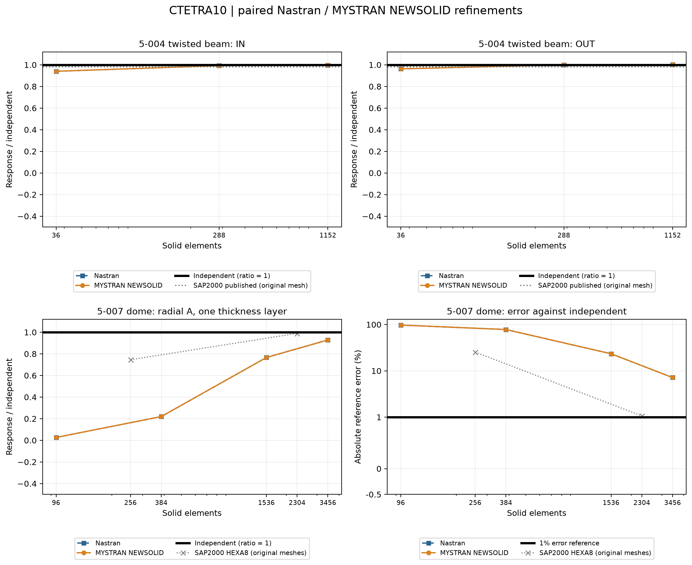
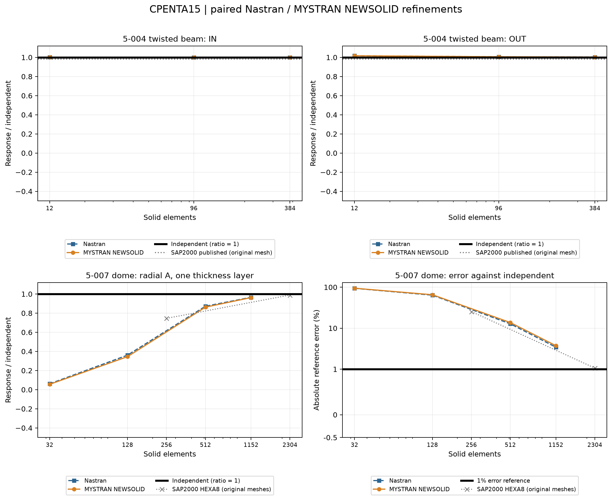
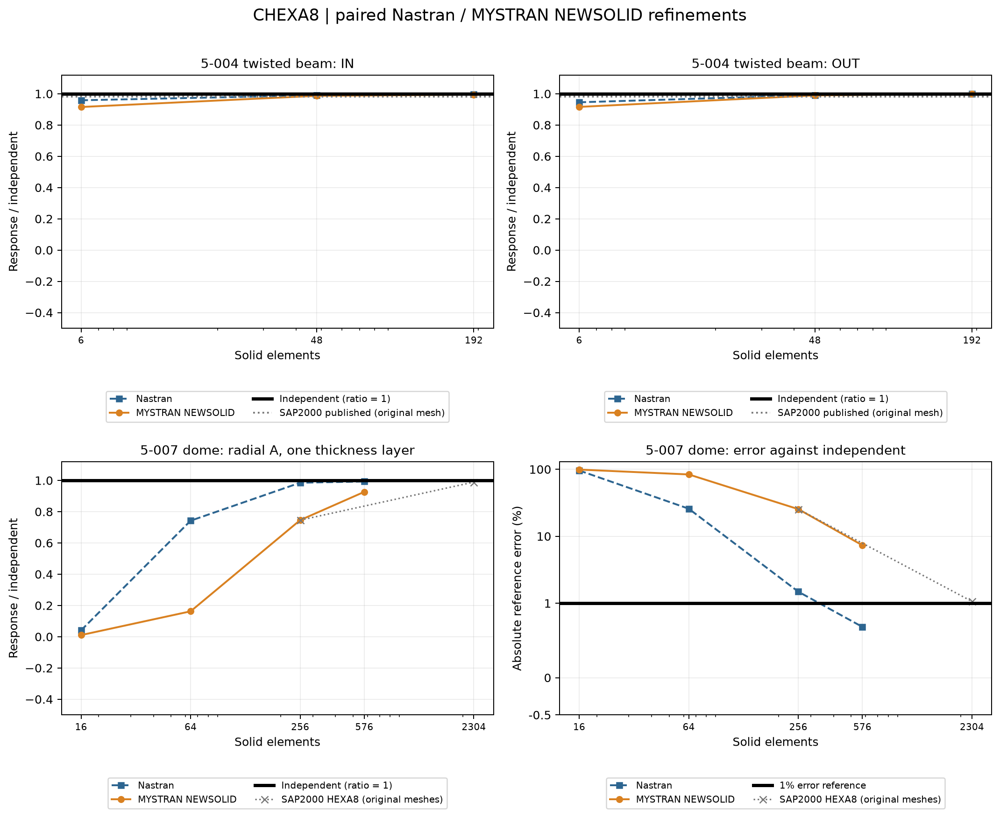
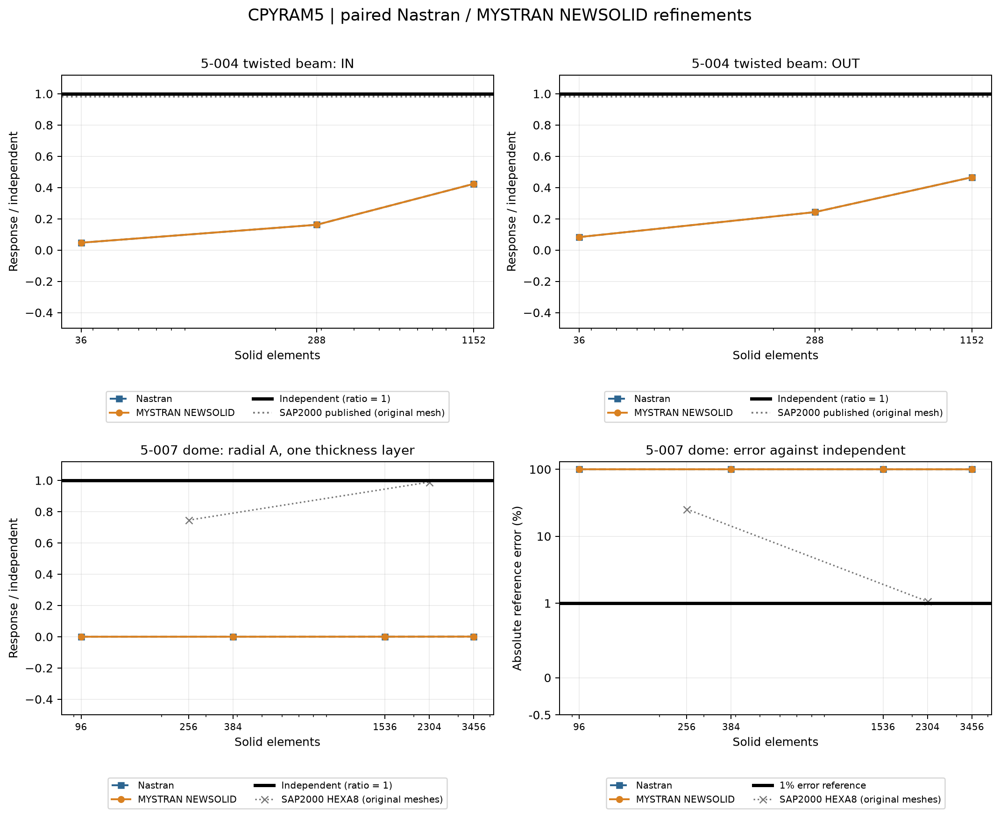

# All solid elements - SAP2000 benchmarks

17 October 2026.

All eight solid families have matched Nastran and MYSTRAN results on both SAP-derived benchmark geometries. CPENTA6 ABE and EAS9 are separate. The comparison contains 56 meshes, 56 Nastran analyses, 63 MYSTRAN selections, and 126 scalar response comparisons. No solver result is inferred from Python or copied from a different element type.

Independent targets: 5-004 IN=0.005429 and OUT=0.001749; 5-007 A=+0.094 and B=-0.094, from the supplied independent benchmark references. Values follow the supplied consistent-unit models. SAP2000 numbers are published original-mesh values, not fresh SAP2000 runs and not invented at new mesh sizes. Curves normalize against independent, so the bold black reference is y=1. Grey SAP2000 lines/markers show only the published original-mesh references; they are not newly solved values for each generated topology. The error graph uses symlog with a -0.5 display margin: its y=1 line means 1% error, and independent error is zero.

## Published reference values

| Case | Responsee | SAP source mesh | Independent | Published SAP2000 |
|---|---|---|---|---|
| 5-004 | IN | Published original SAP mesh; distinct from generated refinement | 0.005429 | 0.005322 |
| 5-004 | OUT | Published original SAP mesh; distinct from generated refinement | 0.001749 | 0.001719 |
| 5-007 | A | Original 16x16x1 HEXA8: 578 nodes / 256 elements | 0.094 | 0.0701 |
| 5-007 | A | Original 48x48x1 HEXA8: 4802 nodes / 2304 elements | 0.094 | 0.093 |

## Meshes

## CTETRA4

| Case | Mesh | Nodes | Elementts | Responsee | MYSTRAN option | Independent | SAP2000* | Nastran | MYSTRAN | N error % | M error % |
|---|---|---|---|---|---|---|---|---|---|---|---|
| 5-004 | 6x1x1 | 28 | 36 | IN | NEWSOLID | 0.005429 | 0.005322 | 0.0001292426 | 0.0006737963 | 97.6194 | 87.58894 |
| 5-004 | 6x1x1 | 28 | 36 | OUT | NEWSOLID | 0.001749 | 0.001719 | 8.878654e-05 | 0.0004973868 | 94.92358 | 71.56165 |
| 5-004 | 12x2x2 | 117 | 288 | IN | NEWSOLID | 0.005429 | 0.005322 | 0.0004680584 | 0.002469162 | 91.37855 | 54.51902 |
| 5-004 | 12x2x2 | 117 | 288 | OUT | NEWSOLID | 0.001749 | 0.001719 | 0.0002681445 | 0.001156214 | 84.66869 | 33.89286 |
| 5-004 | 24x4x2 | 375 | 1152 | IN | NEWSOLID | 0.005429 | 0.005322 | 0.001495 | 0.004307433 | 72.46269 | 20.65882 |
| 5-004 | 24x4x2 | 375 | 1152 | OUT | NEWSOLID | 0.001749 | 0.001719 | 0.0005696493 | 0.001657805 | 67.43 | 5.21412 |
| 5-007 | 4x4_L1 | 50 | 96 | A | NEWSOLID | 0.094 | - | 1.161214e-05 | 5.472678e-05 | 99.98765 | 99.94178 |
| 5-007 | 4x4_L1 | 50 | 96 | B | NEWSOLID | -0.094 | - | -1.110133e-05 | -5.467312e-05 | 99.98819 | 99.94184 |
| 5-007 | 8x8_L1 | 162 | 384 | A | NEWSOLID | 0.094 | - | 4.025815e-05 | 0.000205274 | 99.95717 | 99.78162 |
| 5-007 | 8x8_L1 | 162 | 384 | B | NEWSOLID | -0.094 | - | -3.924863e-05 | -0.0002070219 | 99.95825 | 99.77976 |
| 5-007 | 16x16_L1 | 578 | 1536 | A | NEWSOLID | 0.094 | - | 0.0001450264 | 0.0007535824 | 99.84572 | 99.19832 |
| 5-007 | 16x16_L1 | 578 | 1536 | B | NEWSOLID | -0.094 | - | -0.000144001 | -0.0007682481 | 99.84681 | 99.18271 |
| 5-007 | 24x24_L1 | 1250 | 3456 | A | NEWSOLID | 0.094 | - | 0.0003103354 | 0.001620851 | 99.66986 | 98.27569 |
| 5-007 | 24x24_L1 | 1250 | 3456 | B | NEWSOLID | -0.094 | - | -0.0003109609 | -0.001657335 | 99.66919 | 98.23688 |

## CTETRA10

| Case | Mesh | Nodes | Elementts | Responsee | MYSTRAN option | Independent | SAP2000* | Nastran | MYSTRAN | N error % | M error % |
|---|---|---|---|---|---|---|---|---|---|---|---|
| 5-004 | 6x1x1 | 117 | 36 | IN | NEWSOLID | 0.005429 | 0.005322 | 0.005104682 | 0.005104673 | 5.973815 | 5.973965 |
| 5-004 | 6x1x1 | 117 | 36 | OUT | NEWSOLID | 0.001749 | 0.001719 | 0.001684064 | 0.001684062 | 3.712741 | 3.712841 |
| 5-004 | 12x2x2 | 625 | 288 | IN | NEWSOLID | 0.005429 | 0.005322 | 0.005389167 | 0.005389176 | 0.7337165 | 0.7335488 |
| 5-004 | 12x2x2 | 625 | 288 | OUT | NEWSOLID | 0.001749 | 0.001719 | 0.00175037 | 0.001750372 | 0.07834208 | 0.07842639 |
| 5-004 | 24x4x2 | 2205 | 1152 | IN | NEWSOLID | 0.005429 | 0.005322 | 0.005412509 | 0.005412491 | 0.3037602 | 0.3040827 |
| 5-004 | 24x4x2 | 2205 | 1152 | OUT | NEWSOLID | 0.001749 | 0.001719 | 0.001753138 | 0.001753132 | 0.2366193 | 0.2362359 |
| 5-007 | 4x4_L1 | 243 | 96 | A | NEWSOLID | 0.094 | - | 0.00248868 | 0.00248895 | 97.35247 | 97.35218 |
| 5-007 | 4x4_L1 | 243 | 96 | B | NEWSOLID | -0.094 | - | -0.002580954 | -0.002581238 | 97.2543 | 97.254 |
| 5-007 | 8x8_L1 | 867 | 384 | A | NEWSOLID | 0.094 | - | 0.02065016 | 0.02064928 | 78.03175 | 78.03269 |
| 5-007 | 8x8_L1 | 867 | 384 | B | NEWSOLID | -0.094 | - | -0.02157505 | -0.02157447 | 77.04782 | 77.04843 |
| 5-007 | 16x16_L1 | 3267 | 1536 | A | NEWSOLID | 0.094 | - | 0.07202375 | 0.07202258 | 23.37899 | 23.38023 |
| 5-007 | 16x16_L1 | 3267 | 1536 | B | NEWSOLID | -0.094 | - | -0.0739287 | -0.07392737 | 21.35245 | 21.35386 |
| 5-007 | 24x24_L1 | 7203 | 3456 | A | NEWSOLID | 0.094 | - | 0.0872703 | 0.0872683 | 7.159254 | 7.161387 |
| 5-007 | 24x24_L1 | 7203 | 3456 | B | NEWSOLID | -0.094 | - | -0.08825918 | -0.08825673 | 6.107252 | 6.10986 |

## CPENTA6

| Case | Mesh | Nodes | Elementts | Responsee | MYSTRAN option | Independent | SAP2000* | Nastran | MYSTRAN | N error % | M error % |
|---|---|---|---|---|---|---|---|---|---|---|---|
| 5-004 | 6x1x1 | 28 | 12 | IN | ABE | 0.005429 | 0.005322 | 0.004795643 | 0.005072617 | 11.66618 | 6.564424 |
| 5-004 | 6x1x1 | 28 | 12 | IN | EAS9 | 0.005429 | 0.005322 | 0.004795643 | 0.004894193 | 11.66618 | 9.850934 |
| 5-004 | 6x1x1 | 28 | 12 | OUT | ABE | 0.001749 | 0.001719 | 0.001497015 | 0.001643704 | 14.40738 | 6.02037 |
| 5-004 | 6x1x1 | 28 | 12 | OUT | EAS9 | 0.001749 | 0.001719 | 0.001497015 | 0.001561576 | 14.40738 | 10.71605 |
| 5-004 | 12x2x2 | 117 | 96 | IN | ABE | 0.005429 | 0.005322 | 0.00510252 | 0.005212028 | 6.013622 | 3.996532 |
| 5-004 | 12x2x2 | 117 | 96 | IN | EAS9 | 0.005429 | 0.005322 | 0.00510252 | 0.005165718 | 6.013622 | 4.849551 |
| 5-004 | 12x2x2 | 117 | 96 | OUT | ABE | 0.001749 | 0.001719 | 0.001634537 | 0.001684585 | 6.544481 | 3.682973 |
| 5-004 | 12x2x2 | 117 | 96 | OUT | EAS9 | 0.001749 | 0.001719 | 0.001634537 | 0.001662671 | 6.544481 | 4.935925 |
| 5-004 | 24x4x2 | 375 | 384 | IN | ABE | 0.005429 | 0.005322 | 0.005195501 | 0.005222357 | 4.30096 | 3.80629 |
| 5-004 | 24x4x2 | 375 | 384 | IN | EAS9 | 0.005429 | 0.005322 | 0.005195501 | 0.005211547 | 4.30096 | 4.005395 |
| 5-004 | 24x4x2 | 375 | 384 | OUT | ABE | 0.001749 | 0.001719 | 0.001670758 | 0.001694417 | 4.473528 | 3.120803 |
| 5-004 | 24x4x2 | 375 | 384 | OUT | EAS9 | 0.001749 | 0.001719 | 0.001670758 | 0.00168459 | 4.473528 | 3.682668 |
| 5-007 | 4x4_L1 | 50 | 32 | A | ABE | 0.094 | - | 0.0007690082 | 0.0009456487 | 99.18191 | 98.99399 |
| 5-007 | 4x4_L1 | 50 | 32 | A | EAS9 | 0.094 | - | 0.0007690082 | 3.607387e-05 | 99.18191 | 99.96162 |
| 5-007 | 4x4_L1 | 50 | 32 | B | ABE | -0.094 | - | -0.0007457041 | -0.0009288305 | 99.2067 | 99.01188 |
| 5-007 | 4x4_L1 | 50 | 32 | B | EAS9 | -0.094 | - | -0.0007457041 | -3.506869e-05 | 99.2067 | 99.96269 |
| 5-007 | 8x8_L1 | 162 | 128 | A | ABE | 0.094 | - | 0.01312352 | 0.0146426 | 86.03881 | 84.42276 |
| 5-007 | 8x8_L1 | 162 | 128 | A | EAS9 | 0.094 | - | 0.01312352 | 0.0001309059 | 86.03881 | 99.86074 |
| 5-007 | 8x8_L1 | 162 | 128 | B | ABE | -0.094 | - | -0.01328635 | -0.01500704 | 85.86558 | 84.03507 |
| 5-007 | 8x8_L1 | 162 | 128 | B | EAS9 | -0.094 | - | -0.01328635 | -0.000128471 | 85.86558 | 99.86333 |
| 5-007 | 16x16_L1 | 578 | 512 | A | ABE | 0.094 | - | 0.06744583 | 0.06822096 | 28.24912 | 27.42451 |
| 5-007 | 16x16_L1 | 578 | 512 | A | EAS9 | 0.094 | - | 0.06744583 | 0.0004743571 | 28.24912 | 99.49536 |
| 5-007 | 16x16_L1 | 578 | 512 | B | ABE | -0.094 | - | -0.06899576 | -0.07026374 | 26.60026 | 25.25134 |
| 5-007 | 16x16_L1 | 578 | 512 | B | EAS9 | -0.094 | - | -0.06899576 | -0.0004759953 | 26.60026 | 99.49362 |
| 5-007 | 24x24_L1 | 1250 | 1152 | A | ABE | 0.094 | - | 0.08568744 | 0.08561761 | 8.843145 | 8.917437 |
| 5-007 | 24x24_L1 | 1250 | 1152 | A | EAS9 | 0.094 | - | 0.08568744 | 0.001011309 | 8.843145 | 98.92414 |
| 5-007 | 24x24_L1 | 1250 | 1152 | B | ABE | -0.094 | - | -0.08663048 | -0.08687463 | 7.839916 | 7.580181 |
| 5-007 | 24x24_L1 | 1250 | 1152 | B | EAS9 | -0.094 | - | -0.08663048 | -0.001024034 | 7.839916 | 98.9106 |

## CPENTA15

| Case | Mesh | Nodes | Elementts | Responsee | MYSTRAN option | Independent | SAP2000* | Nastran | MYSTRAN | N error % | M error % |
|---|---|---|---|---|---|---|---|---|---|---|---|
| 5-004 | 6x1x1 | 87 | 12 | IN | NEWSOLID | 0.005429 | 0.005322 | 0.005435474 | 0.005435534 | 0.1192525 | 0.1203504 |
| 5-004 | 6x1x1 | 87 | 12 | OUT | NEWSOLID | 0.001749 | 0.001719 | 0.001778705 | 0.001778567 | 1.698408 | 1.690526 |
| 5-004 | 12x2x2 | 433 | 96 | IN | NEWSOLID | 0.005429 | 0.005322 | 0.00542548 | 0.00542641 | 0.06483722 | 0.04770932 |
| 5-004 | 12x2x2 | 433 | 96 | OUT | NEWSOLID | 0.001749 | 0.001719 | 0.00176034 | 0.001760376 | 0.64838 | 0.6504286 |
| 5-004 | 24x4x2 | 1485 | 384 | IN | NEWSOLID | 0.005429 | 0.005322 | 0.00542181 | 0.005422183 | 0.1324305 | 0.1255721 |
| 5-004 | 24x4x2 | 1485 | 384 | OUT | NEWSOLID | 0.001749 | 0.001719 | 0.001754565 | 0.001754572 | 0.3181939 | 0.3185733 |
| 5-007 | 4x4_L1 | 187 | 32 | A | NEWSOLID | 0.094 | - | 0.005766493 | 0.005237813 | 93.86543 | 94.42786 |
| 5-007 | 4x4_L1 | 187 | 32 | B | NEWSOLID | -0.094 | - | -0.005211746 | -0.004643911 | 94.45559 | 95.05967 |
| 5-007 | 8x8_L1 | 659 | 128 | A | NEWSOLID | 0.094 | - | 0.03394166 | 0.03245932 | 63.89185 | 65.4688 |
| 5-007 | 8x8_L1 | 659 | 128 | B | NEWSOLID | -0.094 | - | -0.03290797 | -0.03139516 | 64.99152 | 66.6009 |
| 5-007 | 16x16_L1 | 2467 | 512 | A | NEWSOLID | 0.094 | - | 0.08198684 | 0.08108681 | 12.77995 | 13.73743 |
| 5-007 | 16x16_L1 | 2467 | 512 | B | NEWSOLID | -0.094 | - | -0.08174426 | -0.0808951 | 13.03802 | 13.94138 |
| 5-007 | 24x24_L1 | 5427 | 1152 | A | NEWSOLID | 0.094 | - | 0.09076561 | 0.09048524 | 3.44084 | 3.739105 |
| 5-007 | 24x24_L1 | 5427 | 1152 | B | NEWSOLID | -0.094 | - | -0.09070489 | -0.09046336 | 3.505438 | 3.76238 |

## CHEXA8

| Case | Mesh | Nodes | Elementts | Responsee | MYSTRAN option | Independent | SAP2000* | Nastran | MYSTRAN | N error % | M error % |
|---|---|---|---|---|---|---|---|---|---|---|---|
| 5-004 | 6x1x1 | 28 | 6 | IN | NEWSOLID | 0.005429 | 0.005322 | 0.005202798 | 0.004969122 | 4.166555 | 8.470766 |
| 5-004 | 6x1x1 | 28 | 6 | OUT | NEWSOLID | 0.001749 | 0.001719 | 0.001653687 | 0.001601891 | 5.449559 | 8.411044 |
| 5-004 | 12x2x2 | 117 | 48 | IN | NEWSOLID | 0.005429 | 0.005322 | 0.005375681 | 0.005356747 | 0.9821178 | 1.33088 |
| 5-004 | 12x2x2 | 117 | 48 | OUT | NEWSOLID | 0.001749 | 0.001719 | 0.001733736 | 0.001730489 | 0.8727373 | 1.058389 |
| 5-004 | 24x4x2 | 375 | 192 | IN | NEWSOLID | 0.005429 | 0.005322 | 0.005401846 | 0.005395933 | 0.5001585 | 0.609081 |
| 5-004 | 24x4x2 | 375 | 192 | OUT | NEWSOLID | 0.001749 | 0.001719 | 0.001747013 | 0.001746183 | 0.1135927 | 0.1610689 |
| 5-007 | 4x4_L1 | 50 | 16 | A | NEWSOLID | 0.094 | - | 0.003837361 | 0.0009824428 | 95.9177 | 98.95485 |
| 5-007 | 4x4_L1 | 50 | 16 | B | NEWSOLID | -0.094 | - | -0.003837361 | -0.0009824428 | 95.9177 | 98.95485 |
| 5-007 | 8x8_L1 | 162 | 64 | A | NEWSOLID | 0.094 | - | 0.06976717 | 0.01527776 | 25.77961 | 83.74706 |
| 5-007 | 8x8_L1 | 162 | 64 | B | NEWSOLID | -0.094 | - | -0.06976717 | -0.01527776 | 25.77961 | 83.74706 |
| 5-007 | 16x16_L1 | 578 | 256 | A | NEWSOLID | 0.094 | - | 0.09260143 | 0.07011965 | 1.487845 | 25.40463 |
| 5-007 | 16x16_L1 | 578 | 256 | B | NEWSOLID | -0.094 | - | -0.09260143 | -0.07011965 | 1.487845 | 25.40463 |
| 5-007 | 24x24_L1 | 1250 | 576 | A | NEWSOLID | 0.094 | - | 0.09335861 | 0.08710673 | 0.68233 | 7.333261 |
| 5-007 | 24x24_L1 | 1250 | 576 | B | NEWSOLID | -0.094 | - | -0.09335861 | -0.08710673 | 0.68233 | 7.333261 |

## CHEXA20

| Case | Mesh | Nodes | Elementts | Responsee | MYSTRAN option | Independent | SAP2000* | Nastran | MYSTRAN | N error % | M error % |
|---|---|---|---|---|---|---|---|---|---|---|---|
| 5-004 | 6x1x1 | 80 | 6 | IN | NEWSOLID | 0.005429 | 0.005322 | 0.00545068 | 0.00545037 | 0.3993354 | 0.3936315 |
| 5-004 | 6x1x1 | 80 | 6 | OUT | NEWSOLID | 0.001749 | 0.001719 | 0.00178539 | 0.001784818 | 2.080622 | 2.047927 |
| 5-004 | 12x2x2 | 381 | 48 | IN | NEWSOLID | 0.005429 | 0.005322 | 0.005430954 | 0.005430989 | 0.03599078 | 0.03662931 |
| 5-004 | 12x2x2 | 381 | 48 | OUT | NEWSOLID | 0.001749 | 0.001719 | 0.001761063 | 0.001761039 | 0.6897196 | 0.6883411 |
| 5-004 | 24x4x2 | 1285 | 192 | IN | NEWSOLID | 0.005429 | 0.005322 | 0.005424081 | 0.005424059 | 0.09060646 | 0.09100387 |
| 5-004 | 24x4x2 | 1285 | 192 | OUT | NEWSOLID | 0.001749 | 0.001719 | 0.001754956 | 0.001754946 | 0.3405624 | 0.339982 |
| 5-007 | 4x4_L1 | 155 | 16 | A | NEWSOLID | 0.094 | - | 0.01235187 | 0.012394 | 86.85971 | 86.8149 |
| 5-007 | 4x4_L1 | 155 | 16 | B | NEWSOLID | -0.094 | - | -0.01235187 | -0.012394 | 86.85971 | 86.8149 |
| 5-007 | 8x8_L1 | 531 | 64 | A | NEWSOLID | 0.094 | - | 0.06144292 | 0.06145078 | 34.63519 | 34.62683 |
| 5-007 | 8x8_L1 | 531 | 64 | B | NEWSOLID | -0.094 | - | -0.06144292 | -0.06145078 | 34.63519 | 34.62683 |
| 5-007 | 16x16_L1 | 1955 | 256 | A | NEWSOLID | 0.094 | - | 0.09068012 | 0.09068536 | 3.531785 | 3.526213 |
| 5-007 | 16x16_L1 | 1955 | 256 | B | NEWSOLID | -0.094 | - | -0.09068012 | -0.09068537 | 3.531785 | 3.526205 |
| 5-007 | 24x24_L1 | 4275 | 576 | A | NEWSOLID | 0.094 | - | 0.09314248 | 0.09314133 | 0.9122596 | 0.9134803 |
| 5-007 | 24x24_L1 | 4275 | 576 | B | NEWSOLID | -0.094 | - | -0.09314248 | -0.09314132 | 0.9122596 | 0.9134882 |

## CPYRAM5

| Case | Mesh | Nodes | Elementts | Responsee | MYSTRAN option | Independent | SAP2000* | Nastran | MYSTRAN | N error % | M error % |
|---|---|---|---|---|---|---|---|---|---|---|---|
| 5-004 | 6x1x1 | 34 | 36 | IN | NEWSOLID | 0.005429 | 0.005322 | 0.0002553373 | 0.0002553375 | 95.29679 | 95.29679 |
| 5-004 | 6x1x1 | 34 | 36 | OUT | NEWSOLID | 0.001749 | 0.001719 | 0.000145305 | 0.000145305 | 91.69211 | 91.69211 |
| 5-004 | 12x2x2 | 165 | 288 | IN | NEWSOLID | 0.005429 | 0.005322 | 0.0008788665 | 0.000878868 | 83.81163 | 83.8116 |
| 5-004 | 12x2x2 | 165 | 288 | OUT | NEWSOLID | 0.001749 | 0.001719 | 0.0004246048 | 0.0004246054 | 75.723 | 75.72296 |
| 5-004 | 24x4x2 | 567 | 1152 | IN | NEWSOLID | 0.005429 | 0.005322 | 0.002300146 | 0.002300135 | 57.63223 | 57.63243 |
| 5-004 | 24x4x2 | 567 | 1152 | OUT | NEWSOLID | 0.001749 | 0.001719 | 0.0008148154 | 0.0008148112 | 53.4125 | 53.41274 |
| 5-007 | 4x4_L1 | 66 | 96 | A | NEWSOLID | 0.094 | - | 3.449054e-06 | 3.449147e-06 | 99.99633 | 99.99633 |
| 5-007 | 4x4_L1 | 66 | 96 | B | NEWSOLID | -0.094 | - | -3.449054e-06 | -3.449147e-06 | 99.99633 | 99.99633 |
| 5-007 | 8x8_L1 | 226 | 384 | A | NEWSOLID | 0.094 | - | 7.591805e-06 | 7.591809e-06 | 99.99192 | 99.99192 |
| 5-007 | 8x8_L1 | 226 | 384 | B | NEWSOLID | -0.094 | - | -7.591805e-06 | -7.591809e-06 | 99.99192 | 99.99192 |
| 5-007 | 16x16_L1 | 834 | 1536 | A | NEWSOLID | 0.094 | - | 2.746437e-05 | 2.746428e-05 | 99.97078 | 99.97078 |
| 5-007 | 16x16_L1 | 834 | 1536 | B | NEWSOLID | -0.094 | - | -2.746437e-05 | -2.746428e-05 | 99.97078 | 99.97078 |
| 5-007 | 24x24_L1 | 1826 | 3456 | A | NEWSOLID | 0.094 | - | 7.31959e-05 | 7.319646e-05 | 99.92213 | 99.92213 |
| 5-007 | 24x24_L1 | 1826 | 3456 | B | NEWSOLID | -0.094 | - | -7.31959e-05 | -7.319646e-05 | 99.92213 | 99.92213 |

## CPYRAM13

| Case | Mesh | Nodes | Elementts | Responsee | MYSTRAN option | Independent | SAP2000* | Nastran | MYSTRAN | N error % | M error % |
|---|---|---|---|---|---|---|---|---|---|---|---|
| 5-004 | 6x1x1 | 134 | 36 | IN | NEWSOLID | 0.005429 | 0.005322 | 0.005344632 | 0.005344617 | 1.554032 | 1.554298 |
| 5-004 | 6x1x1 | 134 | 36 | OUT | NEWSOLID | 0.001749 | 0.001719 | 0.001745984 | 0.001745981 | 0.1724671 | 0.1726202 |
| 5-004 | 12x2x2 | 813 | 288 | IN | NEWSOLID | 0.005429 | 0.005322 | 0.005420306 | 0.005420322 | 0.1601433 | 0.1598498 |
| 5-004 | 12x2x2 | 813 | 288 | OUT | NEWSOLID | 0.001749 | 0.001719 | 0.001756832 | 0.001756835 | 0.4477886 | 0.447975 |
| 5-004 | 24x4x2 | 3013 | 1152 | IN | NEWSOLID | 0.005429 | 0.005322 | 0.00542165 | 0.005421635 | 0.1353759 | 0.135659 |
| 5-004 | 24x4x2 | 3013 | 1152 | OUT | NEWSOLID | 0.001749 | 0.001719 | 0.001754411 | 0.001754405 | 0.3093772 | 0.3090284 |
| 5-007 | 4x4_L1 | 299 | 96 | A | NEWSOLID | 0.094 | - | 0.006281598 | 0.006282498 | 93.31745 | 93.31649 |
| 5-007 | 4x4_L1 | 299 | 96 | B | NEWSOLID | -0.094 | - | -0.006281598 | -0.006282498 | 93.31745 | 93.31649 |
| 5-007 | 8x8_L1 | 1107 | 384 | A | NEWSOLID | 0.094 | - | 0.04928058 | 0.04927996 | 47.57385 | 47.57451 |
| 5-007 | 8x8_L1 | 1107 | 384 | B | NEWSOLID | -0.094 | - | -0.04928058 | -0.04927996 | 47.57385 | 47.57451 |
| 5-007 | 16x16_L1 | 4259 | 1536 | A | NEWSOLID | 0.094 | - | 0.08783739 | 0.08783923 | 6.555963 | 6.554006 |
| 5-007 | 16x16_L1 | 4259 | 1536 | B | NEWSOLID | -0.094 | - | -0.08783739 | -0.08783923 | 6.555963 | 6.55401 |
| 5-007 | 24x24_L1 | 9459 | 3456 | A | NEWSOLID | 0.094 | - | 0.09221994 | 0.09221989 | 1.893683 | 1.893735 |
| 5-007 | 24x24_L1 | 9459 | 3456 | B | NEWSOLID | -0.094 | - | -0.09221994 | -0.09221989 | 1.893679 | 1.893735 |

## Model checks

Both solvers receive identical emitted coordinates, connectivity, materials, physical loads and translations. Quadratic midsides are shared edge midpoints and inherit constraints common to both end nodes. Geometry is kept identical between linear/quadratic versions of each base grid; midsides are not projected to a different sphere. Beam wedge triangles are in the cross-section and extruded along X, preserving the prior reference orientation; dome wedges are extruded radially. Unused GRID points are removed, and solid rotational DOFs are explicitly constrained in both decks. MYSTRAN uses NEWSOLID with explicit TWO/THREE integration and the supported blank ISOP default; Nastran uses native PSOLID integration defaults. These are formulation comparisons, not a claim of identical element operators.

The 4x4 dome tetra meshes have aspect ratios up to about 127.36. Nastran initially stopped at its default aspect-ratio limit of 100; only TET_AR was raised to 150 for those two coarse decks. Geometry, material, stiffness and determinant checks were not changed. The override is recorded per mesh. A separate audit checks sampled corner-map Jacobians, edge-midpoint consistency, shared faces, exterior boundaries and unused nodes; all 56 meshes pass those checks. Both solver logs and readable OP2 displacements are also required. A successful launcher exit alone is not accepted.

[GEOMCHECK syntax reference](https://help-be.hexagonmi.com/bundle/MSC_Nastran_2022.1_Linear_Static_Analysis_User_Guide/raw/resource/enus/MSC_Nastran_2022.1_Linear_Static_Analysis_User_Guide.pdf). Actual solver checks remain in local F06 files.

## Inputs and reproduction

Download [solid_benchmark_inputs.zip](solid_benchmark_inputs.zip). It contains input decks, an input manifest and run instructions only. Raw solver outputs, binaries, databases and scratch files are not included.

The `five_case` directory contains the inputs for the original MYSTRAN solid comparison. The `comparison_all` directory contains 56 matched mesh models: 56 Nastran decks and 63 MYSTRAN decks, including CPENTA6 ABE/EAS9. Use each deck with its designated solver and inspect the solver diagnostics before comparing results. The original full-precision solver outputs remain in the local validation archive.

Published numerical summaries are in [data](data); these CSVs are derived comparison data, not raw solver output files. Checksums and provenance for the distributed decks are in [input_manifest.json](input_manifest.json).

[Original five-case comparison](mystran_solid_comparison.md).
