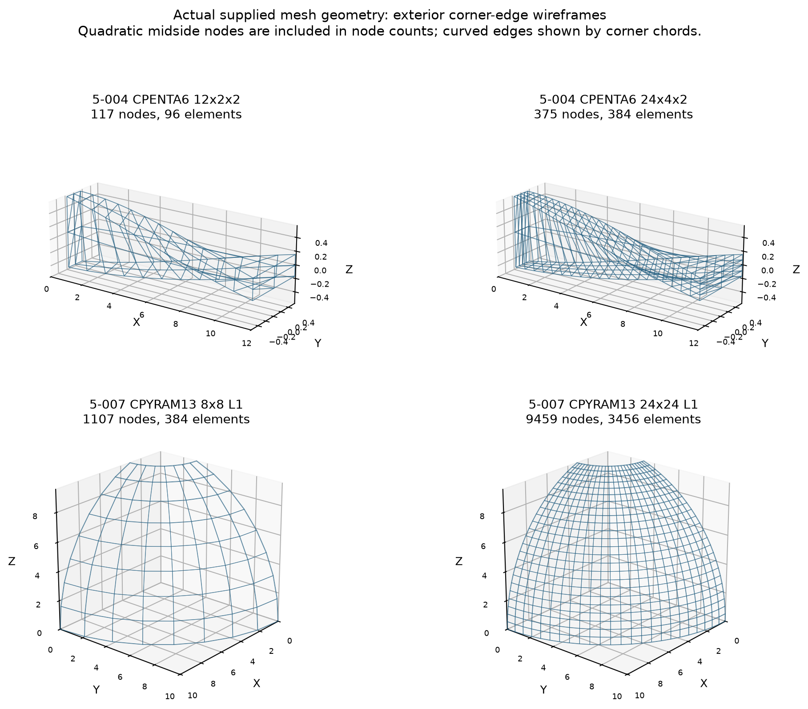
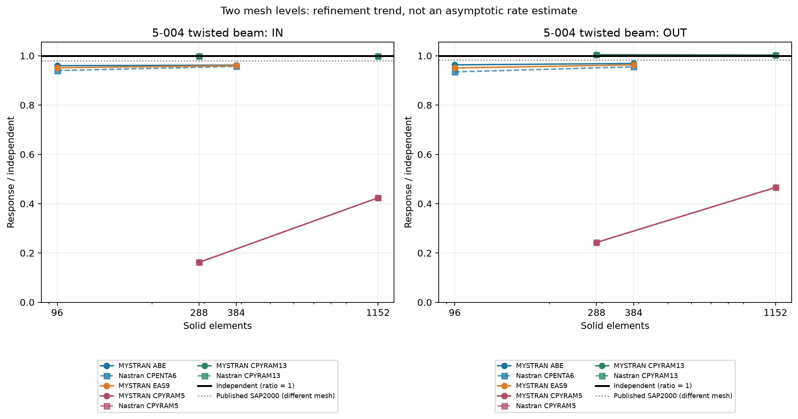
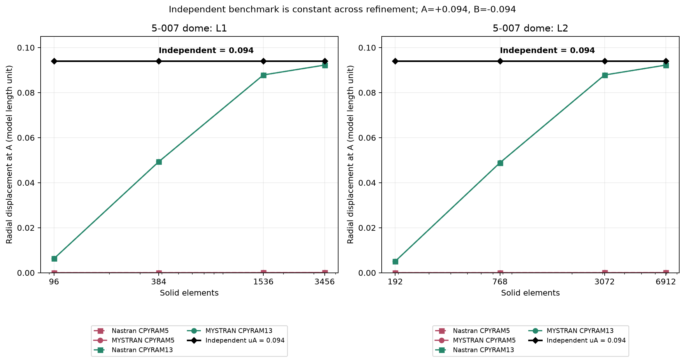
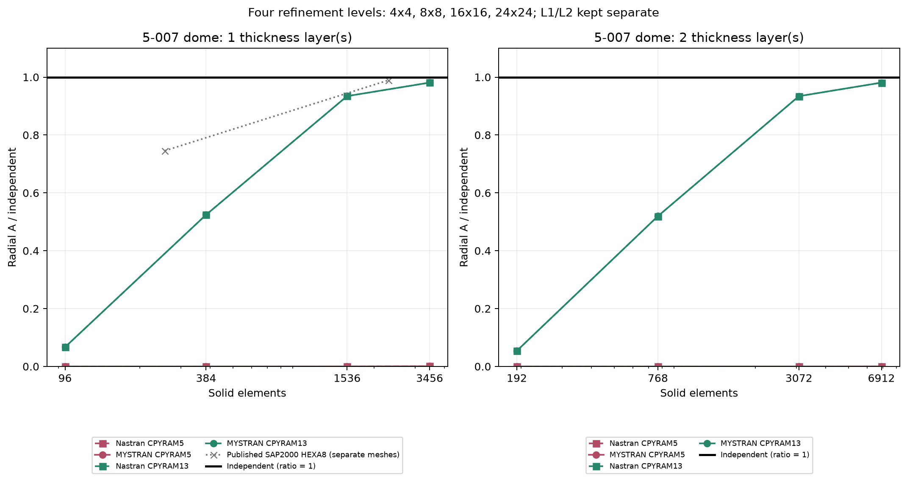
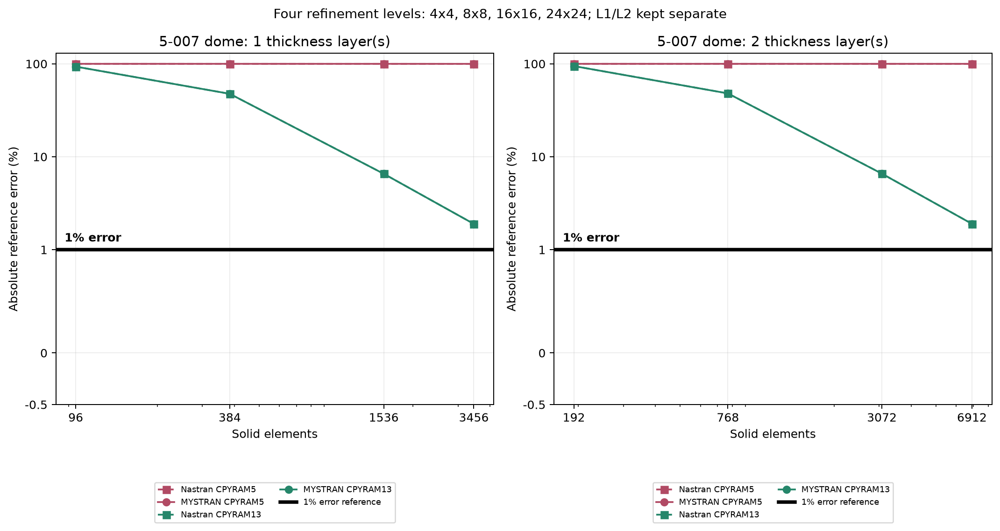
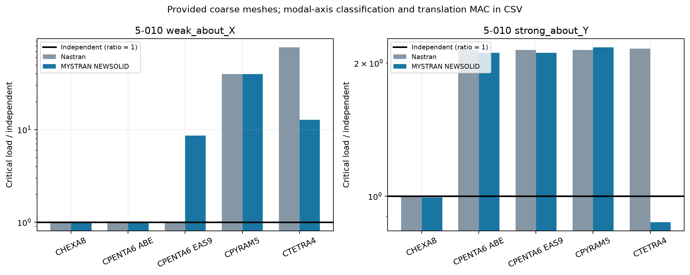

# MYSTRAN solid comparison: Nastran and SAP2000 benchmarks

17 October 2026. **5 cases, 8 solid types, 40 element/mesh/formulation combinations, 71 scalar responses.**
ABE and EAS9 are shown separately. Current MYSTRAN 18.0.A was run on the matched supplied meshes. Nastran values were read from the user's existing successful OP2/F06 files; no Nastran job was rerun for this report.

Independent means analytical targets for 5-001/5-011, and supplied independent benchmark values for 5-004/5-007/5-010. SAP2000 numbers are published references, not a new SAP2000 execution. An original SAP2000 value is not represented as a solve on a different reconstructed mesh.

## Main observations

- 5-001: seven element groups match the Nastran GPSTRESS float payload. CPENTA6 EAS9 is analytical at OP2 precision; ABE is shown separately with its measured error.
- 5-004: CPENTA6 ABE/EAS9 improve the measured IN/OUT response against independent relative to standard Nastran CPENTA6 on these structured meshes. This is case-specific.
- 5-007: CPYRAM13 approaches independent with refinement. CPYRAM5 retains much larger discretization errors on the tested mesh series. Nastran and MYSTRAN are close within each formulation.
- 5-010: coarse-mesh buckling varies substantially by element/formulation; both solver errors and modal MAC are retained. No universal superiority claim follows.
- 5-011: ABE/EAS9 give the same uniform-thermal stress as Nastran at OP2 precision.

## Supplied mesh geometry

Exterior corner edges are drawn; quadratic midsides are included in counts. Beam transverse display dimensions are expanded for readability; coordinates are unchanged.

## Mesh refinement

Only two beam mesh levels are available: these are refinement trends, not established asymptotic rates.

Independent uA=+0.094 and uB=-0.094 are the supplied constant benchmark targets, not a separate mesh-dependent solver. The black diamond line shows uA explicitly at every mesh level. On the normalized plot below it is ratio 1.0. The error plot uses symlog scaling with a display lower bound of -0.5 so the bold y=1 line is clearly inside the plot. It denotes 1% error, not the independent solution; independent error is zero. Negative display space does not represent negative absolute errors.

Dome uses 4x4, 8x8, 16x16, 24x24. L1/L2 are separate. Both A/B responses are retained in CSV; figures show A. SAP2000 markers use the original 16x16/48x48 HEXA8 meshes, not pyramid results.

## Finest available mesh in each series

| Case | Elementt | Option | Mesh | Node | Elementtt count | Responsee | Independent | SAP2000* | Nastran | MYSTRAN | N error (%) | M error (%) |
|---|---|---|---|---|---|---|---|---|---|---|---|---|
| 5-004 | CPENTA6 | ABE | 24x4x2 | 375 | 384 | IN | 0.005429 | 0.005322 | 0.0051955009 | 0.0052223565 | 4.3009605 | 3.8062902 |
| 5-004 | CPENTA6 | ABE | 24x4x2 | 375 | 384 | OUT | 0.001749 | 0.001719 | 0.001670758 | 0.0016944171 | 4.4735278 | 3.1208035 |
| 5-004 | CPENTA6 | EAS9 | 24x4x2 | 375 | 384 | IN | 0.005429 | 0.005322 | 0.0051955009 | 0.0052115471 | 4.3009605 | 4.0053949 |
| 5-004 | CPENTA6 | EAS9 | 24x4x2 | 375 | 384 | OUT | 0.001749 | 0.001719 | 0.001670758 | 0.0016845901 | 4.4735278 | 3.6826681 |
| 5-004 | CPYRAM5 | CPYRAM5 | 24x4x2 | 567 | 1152 | IN | 0.005429 | 0.005322 | 0.002300146 | 0.0023001351 | 57.632234 | 57.632435 |
| 5-004 | CPYRAM5 | CPYRAM5 | 24x4x2 | 567 | 1152 | OUT | 0.001749 | 0.001719 | 0.00081481538 | 0.00081481119 | 53.4125 | 53.412739 |
| 5-004 | CPYRAM13 | CPYRAM13 | 24x4x2 | 3013 | 1152 | IN | 0.005429 | 0.005322 | 0.0054215884 | 0.0054215947 | 0.13651843 | 0.13640177 |
| 5-004 | CPYRAM13 | CPYRAM13 | 24x4x2 | 3013 | 1152 | OUT | 0.001749 | 0.001719 | 0.0017543102 | 0.0017543111 | 0.30361346 | 0.30366759 |
| 5-007 | CPYRAM5 | CPYRAM5 | 24x24_L1 | 1826 | 3456 | A | 0.094 | - | 7.3195897e-05 | 7.3196457e-05 | 99.922132 | 99.922131 |
| 5-007 | CPYRAM5 | CPYRAM5 | 24x24_L1 | 1826 | 3456 | B | -0.094 | - | -7.3195897e-05 | -7.3196457e-05 | 99.922132 | 99.922131 |
| 5-007 | CPYRAM5 | CPYRAM5 | 24x24_L2 | 3027 | 6912 | A | 0.094 | - | 3.2806742e-05 | 3.2807318e-05 | 99.965099 | 99.965099 |
| 5-007 | CPYRAM5 | CPYRAM5 | 24x24_L2 | 3027 | 6912 | B | -0.094 | - | -3.2806742e-05 | -3.2807318e-05 | 99.965099 | 99.965099 |
| 5-007 | CPYRAM13 | CPYRAM13 | 24x24_L1 | 9459 | 3456 | A | 0.094 | - | 0.09221999 | 0.092219856 | 1.8936279 | 1.8937706 |
| 5-007 | CPYRAM13 | CPYRAM13 | 24x24_L1 | 9459 | 3456 | B | -0.094 | - | -0.092219986 | -0.092219859 | 1.8936319 | 1.8937666 |
| 5-007 | CPYRAM13 | CPYRAM13 | 24x24_L2 | 17093 | 6912 | A | 0.094 | - | 0.092216246 | 0.092217192 | 1.8976108 | 1.8966042 |
| 5-007 | CPYRAM13 | CPYRAM13 | 24x24_L2 | 17093 | 6912 | B | -0.094 | - | -0.092216235 | -0.092217185 | 1.8976227 | 1.8966121 |

*SAP2000: published original-mesh benchmark. For dome see the separate table below; no unreported SAP value is fabricated at a pyramid mesh. Responseee magnitudes follow each supplied consistent-unit model; do not pool absolute values across cases. Ratios/errors are dimensionless.

## 5-001 patch

Maximum absolute tensor-component error divided by its analytical component magnitude, expressed as percent. The independent target for this error metric is zero. Analytical tensor: [2000, 2000, 2000, 400, 400, 400].

| Elementt | Option | Node | Elementtt count | Output grids | N error (%) | M error (%) |
|---|---|---|---|---|---|---|
| CTETRA4 | NEWSOLID | 47 | 168 | 47 | 0 | 0 |
| CTETRA10 | NEWSOLID | 273 | 168 | 47 | 0 | 0 |
| CPENTA6 | ABE | 16 | 14 | 16 | 18.546211 | 51.252842 |
| CPENTA15 | NEWSOLID | 56 | 14 | 16 | 0 | 0 |
| CHEXA8 | NEWSOLID | 16 | 7 | 16 | 0 | 0 |
| CHEXA20 | NEWSOLID | 48 | 7 | 16 | 0 | 0 |
| CPYRAM5 | NEWSOLID | 23 | 42 | 23 | 0 | 0 |
| CPYRAM13 | NEWSOLID | 111 | 42 | 23 | 0 | 0 |
| CPENTA6 | EAS9 | 16 | 14 | 16 | 18.546211 | 0 |

## 5-010 buckling

Lowest positive mode in each dominant translation axis is compared. Translation-only MAC checks shape correspondence on common GRID IDs. MYSTRAN scalars are read from F06: its current OUG buckling records expose mode numbers rather than eigenvalues to the installed reader. Shapes are from OP2. The one-subcase Nastran SOL105 is translated to explicit static-preload and STATSUB buckling subcases for MYSTRAN, preserving physical loads/restraints.

| Case | Elementt | Option | Mesh | Node | Elementtt count | Responsee | Independent | SAP2000* | Nastran | MYSTRAN | N error (%) | M error (%) | Modal MAC |
|---|---|---|---|---|---|---|---|---|---|---|---|---|---|
| 5-010 | CHEXA8 | NEWSOLID | provided_SOL105 | 78 | 24 | weak_about_X | 0.888 | 0.891 | 0.8906433 | 0.8914981 | 0.29766876 | 0.39393018 | 0.99999999 |
| 5-010 | CHEXA8 | NEWSOLID | provided_SOL105 | 78 | 24 | strong_about_Y | 127.91 | 127.12 | 128.12328 | 127.1197 | 0.16673892 | 0.61785631 | 0.99999986 |
| 5-010 | CPENTA6 | ABE | provided_SOL105 | 78 | 48 | weak_about_X | 0.888 | 0.891 | 0.89096677 | 0.8912389 | 0.33409606 | 0.36474099 | 0.99999999 |
| 5-010 | CPENTA6 | ABE | provided_SOL105 | 78 | 48 | strong_about_Y | 127.91 | 127.12 | 273.86945 | 269.8431 | 114.11105 | 110.96326 | 0.99999937 |
| 5-010 | CPENTA6 | EAS9 | provided_SOL105 | 78 | 48 | weak_about_X | 0.888 | 0.891 | 0.89096677 | 7.680082 | 0.33409606 | 764.8741 | 0.99732096 |
| 5-010 | CPENTA6 | EAS9 | provided_SOL105 | 78 | 48 | strong_about_Y | 127.91 | 127.12 | 273.86945 | 269.8885 | 114.11105 | 110.99875 | 0.99999937 |
| 5-010 | CPYRAM5 | NEWSOLID | provided_SOL105 | 102 | 144 | weak_about_X | 0.888 | 0.891 | 35.315083 | 35.35091 | 3876.9237 | 3880.9583 | 1 |
| 5-010 | CPYRAM5 | NEWSOLID | provided_SOL105 | 102 | 144 | strong_about_Y | 127.91 | 127.12 | 273.98502 | 277.4976 | 114.2014 | 116.94754 | 0.99999942 |
| 5-010 | CTETRA4 | NEWSOLID | provided_SOL105 | 78 | 144 | weak_about_X | 0.888 | 0.891 | 68.603638 | 11.31086 | 7625.6349 | 1173.7455 | 0.99847068 |
| 5-010 | CTETRA4 | NEWSOLID | provided_SOL105 | 78 | 144 | strong_about_Y | 127.91 | 127.12 | 275.95175 | 111.6954 | 115.739 | 12.676569 | 0.99920762 |

## 5-011 uniform thermal stress

| Case | Elementt | Option | Mesh | Node | Elementtt count | Responsee | Independent | SAP2000* | Nastran | MYSTRAN | N error (%) | M error (%) |
|---|---|---|---|---|---|---|---|---|---|---|---|---|
| 5-011 | CPENTA6 | ABE | native_s2k | 242 | 200 | SXX | -733.33333 | -733.33333 | -733.33331 | -733.33331 | 2.7743253e-06 | 2.7743253e-06 |
| 5-011 | CPENTA6 | ABE | native_s2k | 242 | 200 | SYY | -733.33333 | -733.33333 | -733.33331 | -733.33331 | 2.7743253e-06 | 2.7743253e-06 |
| 5-011 | CPENTA6 | EAS9 | native_s2k | 242 | 200 | SXX | -733.33333 | -733.33333 | -733.33331 | -733.33331 | 2.7743253e-06 | 2.7743253e-06 |
| 5-011 | CPENTA6 | EAS9 | native_s2k | 242 | 200 | SYY | -733.33333 | -733.33333 | -733.33331 | -733.33331 | 2.7743253e-06 | 2.7743253e-06 |

## Published SAP2000 dome meshes

| Case | Source mesh | Node | Elementtt count | Independent | SAP2000 |
|---|---|---|---|---|---|
| 5-007 | SAP original a: 16x16x1 HEXA8 | 578 | 256 | 0.094 | 0.0701 |
| 5-007 | SAP original b: 48x48x1 HEXA8 | 4802 | 2304 | 0.094 | 0.093 |

## Checks and provenance

Conversion checks node IDs, connectivity, fixed translations and load vectors. MYSTRAN real fields receive decimal markers; overlong free-field tokens are rounded only as required by its 16-character limit. Maximum coordinate changes are recorded per result. PSOLID integration is explicit for linear HEXA/PENTA where required. Stress/SPC-force requests are omitted in displacement-only sweeps without changing physical loads/restraints. The 5-001 FIXED midsides use the previously audited permutation.

The local validation archive records executable, input and both solver-output hashes. No stiffness code, geometric adjustments, or calibrated factors were introduced. The existing ordinary CHEXA8 corner-Jacobian diagnostic remains in the combined distorted 5-001 deck; its GPSTRESS tables are separately read/compared.

Comparison labels use a reporting resolution of 0.01 percentage point in error difference, not an engineering acceptance tolerance. Near-noise differences are described as equivalent. Agreement between solvers and agreement with independent are different measurements.

## Other cases

| Case | Coverage |
|---|---|
| 5-001 | Fresh paired OP2 GPSTRESS and analytical reference |
| 5-002 | Historical MYSTRAN/Python + independent/SAP; paired Nastran sweep not executed here |
| 5-003 | Historical MYSTRAN/Python + independent/SAP; paired Nastran sweep not executed here |
| 5-004 | Fresh matched MYSTRAN vs supplied Nastran; two mesh levels |
| 5-005 | Historical plate data; thickness provenance needs resolution |
| 5-006 | No verified matched model/reference in inspected bundle |
| 5-007 | Fresh paired results; four mesh levels and L1/L2 separately |
| 5-008 | Pressure audit: restraint/stress convention needs resolution |
| 5-009 | No verified matched model/reference in inspected bundle |
| 5-010 | Fresh paired buckling; five element/formulation selections |
| 5-011 | Fresh paired uniform-thermal stress |
| 5-012 | Historical 4x4/100x100 foundation results; paired Nastran sweep not executed here |
| 5-013 | Native pore-pressure/effective-stress parity not established |

The other cases are listed for coverage only and are not counted as newly paired Nastran results in this report. No curves connect different restraints, loads, or thickness-layer counts.

## Inputs and reproduction

Download [solid_benchmark_inputs.zip](solid_benchmark_inputs.zip). It contains input decks, an input manifest and run instructions only. Raw solver outputs, binaries, databases and scratch files are not included.

The `five_case` directory contains the inputs for the original MYSTRAN solid comparison. The `comparison_all` directory contains 56 matched mesh models: 56 Nastran decks and 63 MYSTRAN decks, including CPENTA6 ABE/EAS9. Use each deck with its designated solver and inspect the solver diagnostics before comparing results. The original full-precision solver outputs remain in the local validation archive.

Published numerical summaries are in [data](data); these CSVs are derived comparison data, not raw solver output files. Checksums and provenance for the distributed decks are in [input_manifest.json](input_manifest.json).
