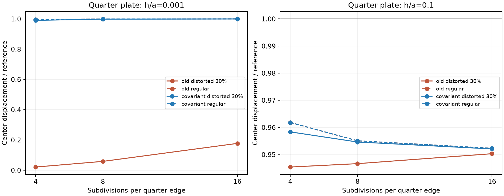

# DSQK covariant shear: native adaptation and validation, 25 October 2026

**Status: implemented and verified as the upgraded selected DSQK branch in the working source; approved by the owner for publication.** `PARAM,QUAD4TYP,DSQK` remains unchanged. Other selector defaults and the standard binary are unchanged. This is a controlled shear update, not a general certification of warped shells or a claim that twisted beam is solved.

## Source adaptation

Only `BS_DSQK` interpolation changes in the mathematical stiffness: tie natural/covariant shear components at four edge midpoints, interpolate them, then apply the inverse Jacobian at the evaluation point. The native Jacobian has parametric-coordinate rows, matching the supplied Python. Discrete-Kirchhoff bending elimination, membrane, pressure/mass, consistent-spin alpha=0.03 and the newly committed case-12 thermal loads are preserved.

A local DSQK guard checks all four projected Jacobian corners before inversion. Nonpositive, nonfinite or relatively near-singular mappings are rejected; no Jacobian is silently clamped. For the bilinear projected map the determinant is affine, so these minima bound the integration/tying points. Valid reversed winding is evaluated in its corresponding right-handed element basis.

Prescribed shear revealed a pre-existing output defect: DSQK's complete assumed-shear row was multiplied by the legacy PHI_SQ factor, sometimes producing zero reported shear. `ELEM_STRE_STRN_ARRAYS` now bypasses that multiplier **only for CQUAD4/DSQK**, analogously to the existing direct Q8/T6 branches. The global PHI_SQ value is not modified. This output-only correction does not change K, loads, bending, other formulation recovery or eigensolvers. A mixed DSQK/MIN3 model confirms unchanged MIN3 stresses/forces.

The outdated generated Fortran file was not copied over the current kernel. The isolated shear function was reconciled with commit bad8cafb, preserving later consistent-spin/thermal work. The same narrow changes are applied to the main source tree without overwriting unrelated edits.

## Results

| Distorted thin quarter plate, h/a=0.001 | Cartesian tying | Covariant tying |
|---|---:|---:|
| n=4 | 0.0212 | 0.9906 |
| n=8 | 0.0586 | 0.9984 |
| n=16 | 0.1774 | 0.9998 |

Values are native center-displacement/reference ratios, reproduced by Python with identical coordinates, tributary nodal loads and hard simply supported quarter-model BCs. The supplied approximate reference is `0.00406*a^4/D + 0.0737*a^2/((5/6)*G*h)`, unchanged between variants. Regular meshes are unchanged to reported precision. At h/a=0.1 with 30% distortion, n8 improves from 0.9467 to 0.9546.

The supplied constant-curvature shear-free test was rerun: rectangle energy ratio stays 1; parallelogram 2.3117 -> 1, trapezoid 3.6245 -> 1, skew 2.6186 -> 1. Candidate parasitic shear is at roundoff for these flat shapes. Native/Python matrix parity confirms the corresponding native operator.

## Native verification

- **132/132 retained SOL 101 runs complete**: 66 old Cartesian/spin and 66 covariant/spin cases. No SOL 105, geometric-stiffness, DARPACK or tolerance modifications.
- **14 focused Python/native checks pass**, including skew/rotation/cyclic/reversed numbering and exact 2-002, 2-004 and hemisphere decks. Maximum stiffness relative difference 5.188e-16; printed displacement differences are at F06 precision.
- Ten shape/version native matrices plus 24 prescribed membrane/bending/shear shape/version runs cover rectangle, parallelogram, trapezoid, skew and a warped-facet diagnostic. Candidate fiber stresses agree with Python after putting tensors in the same reported basis; candidate shear-resultants agree with the assumed-shear operator. Old zero-shear output is retained as a known baseline defect, not declared correct.
- **24 native distorted-plate checks** (two thicknesses, regular/30%-distorted, n4/n8/n16, old/new) agree with Python.
- Perturbed cylindrical-roof and spherical meshes preserve the analytical surface radius and boundary nodes; original discrete nodal loads/output frames are retained. Four old/new runs match Python K and displacement vectors. These are matched-code diagnostics, not proof of distributed-load integration accuracy on the perturbed mesh.
- Concave, self-intersecting and collapsed mappings are rejected as expected. These expected input rejections are not solver-completion passes.
- Mechanical membrane+bending F06/OP2 stress and force values agree within printed/float32 precision.
- **22 thermal F06/OP2 checks and 22 multi-element/multi-subcase gradient/TREF checks pass**, including unchanged controls for other families.

## Trade-offs and limits retained

- 2-014b DSQK UZ changes 0.01892245 -> **0.01921166 in**, target 0.01931; error improves from 2.0070% to **0.5093%**. Thermal load integration itself is unchanged; the new shear stiffness changes the response.
- Hemisphere n32 UX is 0.09326544 against 0.094, error **0.7814%**, close to the Cartesian/spin result.
- **2-004 remains a known fail**: n24 UZ error approximately 49.17%, UY error approximately 64.81%. This update does not repair assumed-orthogonality/bending limitations.
- **Warped rigid-rotation objectivity remains a known limitation in both old and new kernels.** On the supplied warped facet, physical rigid-rotation residuals reach about 0.0099 after normalization by K and the displacement norm, despite nullity six. The incremental shear change acting on those rigid fields is only 2.40e-17 relative; the inherited membrane/bending/facet treatment remains responsible for the tested nonzero residual. Nullity six alone is not proof of the correct rigid-body nullspace. No curved-facet redesign is included here.
- Default isotropic recovery is tested. DEBUG176 SE/STE alternatives, laminates and arbitrary nodal-thickness/director configurations are not certified by this audit.

## Evidence / reproduction

[Static comparison CSV](static_comparison.csv), [distorted plate CSV](distorted_plates.csv), [focused parity](parity_DSQK.json), [shape/recovery checks](extended_matrix_recovery.json), [curved/mapping/mixed tests](geometry_checks.json), [mechanical OP2](output_parity.json), [thermal OP2](op2_checks.json), [gradient/TREF](multi_gradient_checks.json), [provenance](provenance.json).

Local workspace `H:/Projects/MYSTRAN/codex_mod/dsqk_covariant_20261025` retains source_before.f90, recovery_before.f90, the original handoff, Python logs, raw DAT/F06/OP2, run hashes and test drivers. The candidate build is an incremental rebuild of changed files in the preceding clean full publication build, not another full clean build of the dirty main tree. Tested executable: `bin/mystran.exe` in that workspace. Standard `source/Binaries/mystran.exe` is unchanged.
